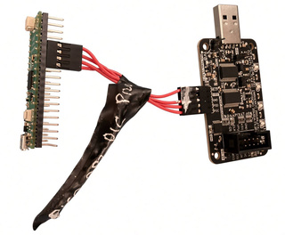
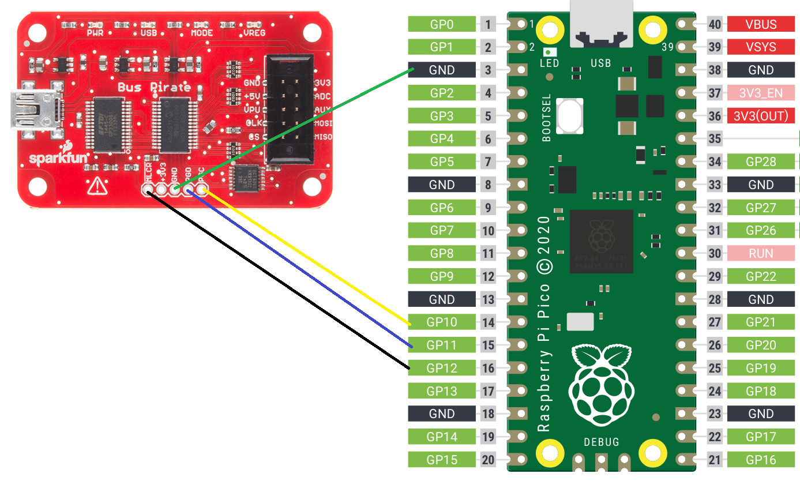
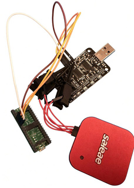

# bp3unbricker

bp3unbricker unbricks a Bus Pirate v3 with a Raspberry Pi Pico or Pico 2. The Pico connects to
the Bus Pirate's ICSP header, the programming port of its PIC24FJ64GA002 microcontroller (the
PIC). It writes the PIC's whole flash memory with the Pico's built-in image: bootloader v4.5 and
Community Firmware v7.1.12, the `BPCOMPBZ` build of
[buzzpirat](https://github.com/therealdreg/buzzpirat) made for original Bus Pirate v3 boards.
The PIC can be factory-blank, erased or corrupted. Before it reports success, the Pico reads all
22016 instructions back and compares them with the image. It needs no PICkit, MPLAB or drivers:
once the Pico is wired up, a one-second press of its BOOTSEL button does the rest.



With a computer, the Python script `bp3unbricker.py` turns the Pico into a full programmer for
the Bus Pirate v3. It writes any `.hex` file, such as another firmware version, an old official
release or your own build, and reads the PIC back to save or verify it. It can also write a
bootloader alone, so that buzzloader, buzzpirat's firmware loader, can load the firmware over
USB. There are two to choose from: [bp3mitloader](https://github.com/therealdreg/bp3mitloader)
under the MIT license, and the ds30 bootloader v4.5 of the built-in image under the GPL.

## Contents

- [What you need](#what-you-need)
- [Wiring](#wiring)
- [Unbrick in 3 steps](#unbrick-in-3-steps)
- [Troubleshooting](#troubleshooting)
- [Using a computer](#using-a-computer)
  - [The Pico's console](#the-picos-console)
  - [Install bp3unbricker.py](#install-bp3unbrickerpy)
  - [Program any .hex file](#program-any-hex-file)
  - [Write only a bootloader, then use buzzloader](#write-only-a-bootloader-then-use-buzzloader)
  - [Update the Pico](#update-the-pico)
- [What protects the Bus Pirate](#what-protects-the-bus-pirate)
- [Results on the bench](#results-on-the-bench)
- [How it works](#how-it-works)
- [The Bus Pirate v3 bootloaders and buzzloader](#the-bus-pirate-v3-bootloaders-and-buzzloader)
- [For developers](#for-developers)
- [Reference documents](#reference-documents)
- [Related](#related)

## What you need

- A Raspberry Pi Pico (RP2040) or Pico 2 (RP2350). The H versions are the same boards with
  headers. From here on, "Pico" means either board.
- Four female-to-female jumper wires, 15 cm long at most. Both boards were tested with 15 cm
  wires and with shorter ones, which give cleaner signals.
- Two USB cables: one for the Pico, and one to power the Bus Pirate from its own USB port.
- A computer, to copy one file to the Pico and to check the Bus Pirate afterwards. Unbricking
  itself needs no computer.

## Wiring



Four wires connect the Bus Pirate's ICSP header, JP2, to the Pico. The Pico 2 has the same
pinout.

| Bus Pirate JP2 pin | Signal | Pico pin | Wire in the diagram |
|---|---|---|---|
| 1 | PGC, clock (Pico to Bus Pirate) | 14 (GP10) | yellow |
| 2 | PGD, data (both ways) | 15 (GP11) | blue |
| 3 | GND | 3, or any other GND pin (8, 13, 18, ...) | green |
| 4 | 3V3 | none, leave it unconnected | none |
| 5 | MCLR, reset (Pico to Bus Pirate) | 16 (GP12) | black |

**Do not connect 3V3.** The Bus Pirate runs from its own USB cable.

Never leave an unpowered Pico wired to a powered Bus Pirate: the Pico's pins would pull MCLR
down and keep the Bus Pirate in reset.

## Unbrick in 3 steps

1. Install bp3unbricker on the Pico. Download the file for your board from the
   [latest release](https://github.com/therealdreg/bp3unbricker/releases/latest). Hold the
   Pico's BOOTSEL button while you plug it into a computer, then release it. Copy the file to
   the drive that appears:

   | Board | File | Drive |
   |---|---|---|
   | Pico (RP2040) | [`bp3unbricker-pico.uf2`](https://github.com/therealdreg/bp3unbricker/releases/latest/download/bp3unbricker-pico.uf2) | `RPI-RP2` |
   | Pico 2 (RP2350) | [`bp3unbricker-pico2.uf2`](https://github.com/therealdreg/bp3unbricker/releases/latest/download/bp3unbricker-pico2.uf2) | `RP2350` |

   The Pico ignores a file for the other board and the drive stays open: copy the right one.
   [`SHA256SUMS.txt`](https://github.com/therealdreg/bp3unbricker/releases/latest/download/SHA256SUMS.txt)
   holds the SHA-256 of both UF2 files.

2. Wire the Pico as shown in [Wiring](#wiring). Power it from the computer or a USB charger,
   then plug in the Bus Pirate's USB cable.

3. With the Pico running, hold its BOOTSEL button until the LED starts blinking fast, then let
   go. You can also type `flash` in the [Pico's console](#the-picos-console).

| Pico LED | Meaning |
|---|---|
| A short blink every second | Ready. |
| On while you hold BOOTSEL | Keep holding. Programming starts after one second. |
| Fast blinking | Working, for about 23 s. |
| Steady on | The last operation succeeded. After BOOTSEL or `flash`, the Bus Pirate runs the new firmware. |
| 1 to 6 blinks, a pause, repeated | An error. The number of blinks tells which one (see [Troubleshooting](#troubleshooting)). |

When the LED stays on, remove the wires: the Bus Pirate is ready. To check it, open its own
serial port, not the Pico's, at 115200 baud (see [Using a computer](#using-a-computer) to tell
the two apart). Type `i` and press Enter. The Bus Pirate answers:

```
Bus Pirate v3.5
Community Firmware v7.1 - buzzpirat.com by Dreg BPCOMP TWELVE [...] Bootloader v4.5
```

The Pico keeps the result and the last 16 KB of the run's output, even after a BOOTSEL run with
no terminal open. Open the [Pico's console](#the-picos-console) without unplugging the Pico: the
result follows the banner, and `log` prints the output. On a compatible board whose LED is not
on GP25, this is the only way to read the result.

## Troubleshooting

| LED | Console message | Cause and what to do |
|---|---|---|
| 1 blink | `no target` | The Bus Pirate has no power, MCLR or GND is not wired, or another programmer holds MCLR low. The console also says whether the MCLR wire is open or on another Pico pin. |
| 2 blinks | `MCLR/PGC/PGD do not follow the programmer` | A short circuit, or a PICkit still connected and driving the lines. |
| 3 blinks | `the PIC does not answer over ICSP`, `wrong or missing device ID` | PGC and PGD swapped or not connected, or not a Bus Pirate v3. |
| 4 blinks | `flash operation timed out`, `flash operation failed (WRERR)`, `chip is not blank` | The erase or a write failed. Check the wires and the Bus Pirate's power. After `blank`, it only means the PIC is not erased. |
| 5 blinks | `verify failed` | After a flash, all 3 attempts failed: bad wiring or contacts, or a damaged PIC. Use shorter wires, or type `speed slow` in the console and try again. After `verify`, the PIC differs from the image. |
| 6 blinks | `image is corrupt` | A corrupt built-in image means the Pico's flash memory is damaged: copy the UF2 file again ([step 1](#unbrick-in-3-steps)). A corrupt uploaded image changed in the Pico's RAM: send it again. |

- If the computer loses the Pico or the serial port times out, check the USB setup in
  [Using a computer](#using-a-computer).
- After a PICkit or MPLAB session, the Bus Pirate may stay in its bootloader with its MODE LED
  on, because the PICkit keeps PGC low. Disconnect the PICkit and replug the Bus Pirate, or send
  it the byte 0xE4 through its serial port with `python bp3unbricker.py bp PORT boot`.

### Held in reset after a failed write

When a flash fails after its erase has started, the Pico holds the PIC in reset, so it cannot
run a half-written flash. A failed `erase`, a failed `test` pass and a failed flash at the end
of `test` do the same. The console prints
`The PIC is held in reset. Fix the problem and run the command again.` Then `status` shows
`Bus Pirate: not checked, MCLR held low after a failed write (until 'release')`.

The next command that uses the PIC ends the hold, and so do `release`, `raw exit` and
`raw release`. `status`, `pins` and `bench` leave it in place. After `release`, or after a
command that only reads (`id`, `verify`, `blank`, `dump`, `ping`), the PIC runs whatever its
flash memory holds, even half-written firmware.

A flash that fails before its erase releases the Bus Pirate as usual. After a line fault, or
when the PIC does not answer, the console adds `Nothing was written.`

Two other messages can follow a failed write:

- `The PIC could not be held in reset: something else drives MCLR.` A short or another
  programmer keeps MCLR high 1 ms after the Pico drives it low, so the Pico lets go instead of
  fighting it.
- `MCLR is held low: the PIC stays in reset if the MCLR wire is connected.` The last attempt
  found no target, because the power went or the MCLR wire came loose.

## Using a computer

Plug the Pico and the Bus Pirate straight into the computer with short USB cables, not through a
hub. Run the terminal and `bp3unbricker.py` on the computer's own operating system: USB passed
through to a virtual machine can drop or slow down the serial port, and lose the Pico while it
reboots, for example during `install`.

Each board shows up as its own serial port: `COM3` or similar in the Windows Device Manager, and
on Linux usually `/dev/ttyACM0` for the Pico and `/dev/ttyUSB0` for the Bus Pirate. To tell them
apart, unplug one board and see which port goes away. Close any terminal on a port before
`bp3unbricker.py` or buzzloader uses it.

### The Pico's console

Open the Pico's port in any terminal, such as PuTTY, Tera Term, `screen` or the Arduino serial
monitor, with any line ending (CR, LF or both). The terminal must raise DTR, as most do, or the
Pico sends nothing. Any baud rate works except 1200, which reboots the Pico into BOOTSEL mode.

When a terminal opens the port, the Pico prints its banner, the wiring, the images it holds and
the last result, then the `>` prompt.

| Command | What it does |
|---|---|
| `flash` | Erase the PIC, check that it is blank, write the built-in image, verify every word and let the Bus Pirate run. |
| `verify` | Compare the PIC with the built-in image, or with the uploaded one for `verify loaded`. |
| `id` | Show the device ID, silicon revision, configuration words and calibration words. |
| `blank` | Check that the PIC is erased. |
| `status` | Show the wiring, the clock, whether the Bus Pirate is detected and the last result. It reports a `jumper` or a [hold in reset](#held-in-reset-after-a-failed-write) without ending it. |
| `pins` | Show which free Pico pins see an external pull-up, and the levels of PGC, PGD and MCLR. A line the Pico holds low (PGC after `jumper`, MCLR after a failed write) shows as held. |
| `log` | Print the output of the last operation again. |
| `release` | Release the lines and let the Bus Pirate run. It reports a missing target, such as a Bus Pirate without power. |
| `erase` | Erase the PIC, which leaves the Bus Pirate without firmware. |
| `dump` | Read the whole PIC and print it as Intel HEX, in MPLAB IPE's layout. |
| `test [seed]` | Run a self-test: erase, write and verify the whole flash twice, with random words and then all zeros. Configuration bits that could leave the PIC unusable are forced to safe values. A final `flash` writes the built-in image back. |
| `speed slow\|normal\|fast` | Set the PGC clock to ~240 kHz, ~850 kHz (the default) or ~1.5 MHz (~1.75 MHz on the Pico 2), until the next `speed` or a restart. |
| `bootloader [mit\|ds30]` | `bootloader` and `bootloader mit` write only bp3mitloader. `bootloader ds30` writes only the ds30 bootloader of the built-in image (see [Write only a bootloader](#write-only-a-bootloader-then-use-buzzloader)). |
| `jumper` | Hold PGC low, as the PGC-PGD jumper does, and restart the Bus Pirate. Its bootloader then waits for buzzloader until `release` or the next operation. |
| `load [name]` | Receive an image from `bp3unbricker.py` (see [The upload protocol](#the-upload-protocol)). |
| `flash loaded` | Write the uploaded image as `flash` writes the built-in one. `bp3unbricker.py flash FILE.hex` uploads the file and runs this. |
| `bootsel` | Reboot the Pico into BOOTSEL mode. |
| `help` | List the commands. |

`help` also lists bring-up helpers that unbricking does not need: `ping`, `bench`, `entry`,
`pgdpull` and `raw` (see [Console bring-up helpers](#console-bring-up-helpers)).

### Install bp3unbricker.py

`bp3unbricker.py` is one Python file for Windows, Linux and macOS. It needs Python 3.8 or later
and pyserial (`pip install pyserial`). The "Source code (zip)" of the
[latest release](https://github.com/therealdreg/bp3unbricker/releases/latest) holds
`bp3unbricker.py` and the matching `bp3unbricker.c`, which `bootloader` needs in the same
folder. Unzip it and open a command prompt in the unzipped folder.

`bp3unbricker.py` finds the Pico by itself. With more than one Raspberry Pi serial device, such
as a second Pico or a Debug Probe, choose the Pico's port with `--port`. On Linux, you may have
to join the `dialout` group to open the ports.

Every command starts with `python bp3unbricker.py` (`python3` on Linux and macOS):

| Command | What it does |
|---|---|
| `info FILE.hex` | Check a `.hex` file. No Pico needed. |
| `flash FILE.hex` | Upload the file, then erase, program, verify, read the whole PIC back and let the Bus Pirate run. |
| `flash` | Write the built-in image, as BOOTSEL does. |
| `verify [FILE.hex]` | Compare the whole PIC with the file, or with the built-in image when FILE is left out. |
| `read backup.hex` | Save the whole PIC as Intel HEX, in the MPLAB layout. |
| `bootloader [mit\|ds30]` | Write only bp3mitloader, or with `ds30` only the ds30 bootloader of the built-in image, then read the whole PIC back. |
| `jumper`, `id`, `blank`, `erase`, `status`, `log`, `release` | Run the console command of the same name. |
| `run "COMMAND"` | Run one console command. |
| `term` | Open an interactive console. Ctrl+C quits. |
| `install FILE.uf2` | Copy a release's UF2 file to the Pico (see [Update the Pico](#update-the-pico)). |
| `bp PORT info\|hello\|boot\|raw TEXT` | Talk to the Bus Pirate's own serial port. `info` sends the firmware's `i` command, `hello` the bootloader's HELLO, `boot` the byte 0xE4 that leaves the bootloader (then `i`), and `raw` any text. |

`--port` and `--speed slow|normal|fast` go before the command, as in
`python bp3unbricker.py --speed slow flash FILE.hex`. `--speed` sets the PGC clock for that run
and leaves the Pico at `normal` afterwards.

The exit status is 0 on success, 1 when the operation fails and 2 for a bad `.hex` file or bad
arguments. `--help` lists every command, and `--version` prints the version.

### Program any .hex file

These examples use files from buzzpirat's
[`bin/oldfirm/`](https://github.com/therealdreg/buzzpirat/tree/main/bin/oldfirm) folder, copied
next to `bp3unbricker.py`. In `cmd.exe`, leave out the `# ...` comments:

```
python bp3unbricker.py flash BPv3-firmware-v7.1_Dreg-and-Bootloader-v4.5-Aug-2023_Dreg.hex
python bp3unbricker.py flash --add-config BPv3-frimware-v6.1.hex     # official v6.1, no bootloader
python bp3unbricker.py flash                                         # back to BPCOMPBZ v7.1.12
```

The BOOTSEL button always writes the built-in image, never an uploaded one.

Bus Pirate firmware does not run with the PIC's configuration words erased, so `flash` refuses a
file without them. For such a file, `--add-config` adds the Bus Pirate v3 values (CW2=0xF9DF
CW1=0x3F7F), and `--no-config` leaves them erased. Neither option changes a file that has its
own words. Configuration words that would leave the Bus Pirate unusable need `--force`: code
protection, write protection, debug mode, JTAG, a reserved value, or WINDIS=0 without FWDTEN=1.

A file without a bootloader in 0x00A800-0x00ABFB is written as it is, with a note. The firmware
then runs, but cannot be updated over USB until a bootloader is written again.

`bp3unbricker.py` and the Pico check the data at each stage:

| Stage | Checks |
|---|---|
| Reading the `.hex` | Every record checksum, an end-of-file record (so a truncated file is refused), no byte given twice with different values, nothing outside the program flash (0x000000-0x00ABFE), and whole PIC24 instructions whose phantom byte, the unused fourth byte, is zero. |
| Computer to Pico | Each 64-word row carries its row number and a CRC-32 and must be acknowledged. A refused row is sent up to 3 times. The Pico accepts the image only if the CRC-32 of the whole image matches, and a wrong CRC, an abort or a silent computer leaves no usable image. |
| Final read-back | `bp3unbricker.py` reads all 22016 words back (record checksums and the CRC-32 of the read) and compares them with the `.hex` file itself. `--no-readback` skips this step. |

### Write only a bootloader, then use buzzloader

There are two bootloaders to choose from. buzzloader and the firmware work the same way with
both.

| Command | Bootloader | With no firmware |
|---|---|---|
| `bootloader` | [bp3mitloader](https://github.com/therealdreg/bp3mitloader) v4.6, MIT license | It waits in bootloader mode, MODE LED on. |
| `bootloader ds30` | The ds30 bootloader v4.5 of the built-in image, GPL | It prints nothing and waits for `jumper` (see [How the ds30 bootloader v4.5 behaves](#how-the-ds30-bootloader-v45-behaves)). |

Get [buzzloader](https://github.com/therealdreg/buzzpirat/tree/main/bin/buzzloader) from
buzzpirat. With bp3mitloader:

1. Run `python bp3unbricker.py bootloader`, or type `bootloader` in the console.
2. Run `buzzloader --dev=PORT --hex=BPCOMPBZ-firmware-v7.1.12.hex`, where PORT is the Bus
   Pirate's serial port. The file is in buzzpirat's `bin/stablefirm/bpv3comp/` folder.
3. The bootloader starts the firmware by itself, 500 ms after the last page.

With the ds30 bootloader:

1. Run `python bp3unbricker.py bootloader ds30`, or type `bootloader ds30` in the console.
2. Run `python bp3unbricker.py jumper`, or type `jumper` in the console. The Bus Pirate waits in
   its bootloader with the MODE LED on. A PGC-PGD jumper on JP2 does the same without the Pico.
3. Run buzzloader as above.
4. Run `python bp3unbricker.py release`, or remove the jumper and replug the Bus Pirate. The
   bootloader then starts the firmware.

All 11 firmware-only files tested in
[Bootloader and buzzloader cycles](#bootloader-and-buzzloader-cycles) work with both. With a
v7.1 file, buzzloader ends with an error, which is expected. The v7.1 files carry the
configuration words, which sit in the bootloader's page, and the bootloader refuses to erase its
own page. So buzzloader stops at that page with `Erasing page 42, a800...ERROR [50]` and
`Error updating firmware :(`, but the firmware is complete. With the ds30 bootloader and
`BPCOMPBZ-firmware-v7.1.12.hex`, the PIC then holds word for word the image that `flash` writes.
The v5.x and v6.x files have no configuration words, so buzzloader ends with
`Firmware updated successfully :)!`.

`bootloader ds30` writes the same bootloader v4.5 as `flash`, word for word: the reset
`GOTO 0x00A800` and the page 0x00A800-0x00ABFE, with the bootloader's code, its version word and
the configuration words. `bootloader` writes `bp3mitloader.hex` in the same place, with the same
configuration words. Every other word is erased and verified as erased, including the
bootloader's jump to the firmware at 0x00A7FC. From the computer, `bootloader` writes nothing
unless the `bp3unbricker.c` next to `bp3unbricker.py` holds the bootloader built into the Pico.
Afterwards it reads the whole PIC back and checks that it holds the bootloader's words and
nothing else: 339 for bp3mitloader, 206 for the ds30 one. `--no-readback` skips both checks.

### Update the Pico

Download the new UF2 file from the
[latest release](https://github.com/therealdreg/bp3unbricker/releases/latest). Without Python,
copy it as in [step 1](#unbrick-in-3-steps). With Python, run `install`:

```
python bp3unbricker.py install bp3unbricker-pico.uf2      # or bp3unbricker-pico2.uf2
```

If the Pico runs bp3unbricker, `install` first reboots it into BOOTSEL mode by opening its
serial port at 1200 baud. Otherwise, start it in BOOTSEL mode as in step 1.

`install` refuses a file for the other chip. Given a folder, it takes the one UF2 file there for
the Pico's chip.

## What protects the Bus Pirate

- The Pico does not power the Bus Pirate through its pins, except with the bring-up commands
  `pgdpull up` and `raw` (see [Console bring-up helpers](#console-bring-up-helpers)). It drives
  no line high until MCLR has floated high through the Bus Pirate's 2 kOhm pull-up, and stops
  with `no target` if MCLR stays low.
- With the PIC in reset, MCLR, PGC and PGD must read back what the Pico drives. This line check
  catches shorts and a second programmer that still drives the lines.
- The device check accepts only a PIC24FJ64GA002: the PIC must echo two test patterns through
  VISI, then DEVID must read 0x0447.
- The Pico never erases or writes the executive memory, which holds the FRC calibration word
  that the Bus Pirate's UART depends on. The chip erase selects user memory only, and the
  calibration words are only read.
- All 22016 words are verified, the configuration words included. The verify masks the bits that
  [never read back as written](#what-the-programming-specification-does-not-say): the
  unimplemented upper byte of both configuration words, and the reserved CW1 bit 15 ("program as
  0").
- A failed attempt is retried twice, at half and then a quarter of the clock speed. No target, a
  line fault, a wrong device ID and a corrupt image fail at once, because a retry cannot fix
  them. A failed write [holds the PIC in reset](#held-in-reset-after-a-failed-write).
- The built-in image and the two bootloaders each carry a CRC-32 that the Pico checks at boot. A
  corrupt one is never written, and the others still work. Every image, built in or uploaded, is
  checked again before each attempt and after writing. An image that changed in RAM is not tried
  again, and the PIC stays in reset.
- The Pico releases PGC without a pull-down, because the bootloader reads a low PGC as its "stay
  in bootloader" jumper. A released Bus Pirate boots straight into its firmware.

## Results on the bench

All results come from this bench:

- A Bus Pirate v3.5 with a PIC24FJ64GA002 rev B8
- A Raspberry Pi Pico (RP2040 B2) and a Pico 2-compatible board (RP2350 A4)
- Dupont wires of 15 cm, and shorter ones
- A Saleae Logic Pro 8 on the ICSP header

Every test below passed on both boards with both sets of wires, in the same times. The numbers
come from the 15 cm wires unless a result says otherwise.



### Speed

| Operation | Pico (RP2040) | Pico 2 (RP2350) |
|---|---|---|
| `flash` (the Bus Pirate then boots) | 22.9 s (erase 0.2 s, blank check 8 s, 323 rows written in 6.7 s, verify 8 s) | 20.7 s (erase 0.2 s, blank check 7.2 s, 323 rows written in 6.1 s, verify 7.2 s) |
| `flash` at `speed fast` | 11.9 s | 9.8 s |
| `verify` at slow / normal / fast | 26.4 / 8.0 / 4.1 s | 26.0 / 7.2 / 3.3 s |
| `test` | 69.5 s (36.2 s at `speed fast`) | 62.8 s (29.6 s at `speed fast`) |

### Soak runs

A 10-minute soak run on each board and with each set of wires had no error and no retry, with
the Saleae clipped on the lines.

Each round runs one operation at one PGC speed, in rotation: the Pico's self-test, the built-in
image, a random image on all 344 rows, one of the 18 valid buzzpirat `.hex` files, or three full
reads. After each round, `id` must show the same DEVID, DEVREV and calibration words.

| | Pico | Pico 2 |
|---|---|---|
| Rounds | 12 | 15 |
| Chip erases (flashes and self-test passes) | 14 | 18 |
| Full reads compared on the computer | 16 (0.35 M words) | 21 (0.46 M words) |
| Uploads over USB | 6 | 6 |
| Firmware boots checked on the Bus Pirate's serial port | 3 | 3 |

The short wires gave the same counts. An error would have shown up as a retry, a failed verify
or a resent row, and none happened.

An upload test also passed all 22 of its checks. It sends lines that the Pico must refuse: a bad
row CRC, a changed digit, a non-hex digit, a short or 700-character line and an out-of-range row
(344). Then it ends one upload with a wrong image CRC, aborts another and goes silent in the
middle of a third. After each of these the Pico must hold no image, and a clean upload must then
pass.

### Bootloader and buzzloader cycles

For each of the 11 firmware-only `.hex` files of buzzpirat, this cycle ran with each bootloader,
as [Write only a bootloader](#write-only-a-bootloader-then-use-buzzloader) describes it:

1. `bootloader` or `bootloader ds30` writes the bootloader, and a full read-back must show
   nothing else.
2. With no firmware, bp3mitloader must answer HELLO. The ds30 bootloader must stay silent, and
   `jumper` then puts it in bootloader mode.
3. `buzzloader --hello` must find the bootloader.
4. buzzloader writes the firmware.
5. The firmware must answer on that port. bp3mitloader starts it by itself, and the
   ds30 bootloader after `release`.
6. A full read-back must equal what the bootloader and buzzloader should leave, as computed from
   `buzzloader.c`.
7. `id` must show DEVID, DEVREV and the calibration words unchanged.

All 22 cycles and their 224 checks passed. Timed from the computer, `bootloader` took 16.6 s on
the Pico and 15.0 s on the Pico 2 with either bootloader, buzzloader 11.4 to 13.8 s, and a whole
cycle about 1 minute.

| File | buzzloader | Firmware line on the Bus Pirate |
|---|---|---|
| `BPCOMPBZ-firmware-v7.1.12.hex` | 41 pages, then `ERROR [50]` at page 42 | `Community Firmware v7.1 - buzzpirat.com by Dreg BPCOMP TWELVE [...]` |
| `BZ-firmware-v7.1.12.hex` | 41 pages, then `ERROR [50]` | `Community Firmware v7.1 - buzzpirat.com by Dreg BZ TWELVE [...]` |
| `BPv3-firmware-v7.1-Aug-2023_Dreg.hex` | 38 pages, then `ERROR [50]` | `Community Firmware v7.1 - build by Dreg Aug two thousand twenty-three buzzpirat dot com [...]` |
| `BPv3-firmware-v7.1-JTAG_SAFE_1_Aug-2023_USBEprom.hex` | 36 pages, then `ERROR [50]` | `Community Firmware v7.1 - goo.gl/gCzQnW [...]` |
| `BPv3-frimware-v6.1.hex` | 42 pages, success | `Firmware v6.1 r1676` |
| `BPv3-firmware-v6.3-r2151.hex` | 42 pages, success | `Firmware v6.3-beta1 r2151` |
| `BPv3-firmware-v6.2-r1981.hex` | 42 pages, success | `Firmware v6.2-beta1 r1981` |
| `BPv3-Firmware-v5.10.hex` | 42 pages, success | `Firmware v5.10 (r559)` |
| `BPv3-Firmware-v5.9.hex` | 42 pages, success | `Firmware v5.9 (r539)` |
| `BPv3-Firmware-v5.9-extras.hex` | 42 pages, success | `Firmware v5.9 (r529) [HiZ 2WIRE 3WIRE KEYB LCD DIO]` |
| `BPv3-Firmware-v5.5.hex` | 42 pages, success | `Firmware v5.5 (r457)` |

Each line ends with `Bootloader v4.6` after bp3mitloader and with `Bootloader v4.5` after the
ds30 bootloader.

### Signal integrity

A Saleae capture of `id` at 500 MS/s decodes cleanly: 4177 clocks, 130 SIX and 19 REGOUT
commands, no leftover bits. PGD never changes while PGC is high, and no glitch shows at 2 ns
resolution.

PGC timing at `speed normal`, against a specified minimum of 40 ns per phase:

| Board | PGC high, min / median | PGC low, min / median | PGD set before PGC rises, min |
|---|---|---|---|
| Pico | 510 / 536 ns | 544 / 672 ns | 512 ns |
| Pico 2 | 498 / 546 ns | 500 / 586 ns | 516 ns |

The short wires gave the same times, 2 ns apart at most.

An analog capture of `id` at 50 MS/s, decoded clock by clock, shows PGD on the latched bits. PGD
is a Schmitt-trigger input: at VDD 3.3 V, a 1 must be above 0.8 VDD (2.64 V) and a 0 below
0.2 VDD (0.66 V).

| PGD, a 1 / a 0 | Pico | Pico 2 |
|---|---|---|
| Sent by the Pico, at PGC rising (where the PIC latches) | 3.23 / 0.04 V | 3.25 / 0.03 V |
| Sent by the PIC, before PGC falls (where the Pico samples) | 3.24 / 0.02 V | 3.24 / 0.01 V |
| Anywhere in those clocks | 3.22 / 0.04 V | 3.24 / 0.03 V |

The short wires gave the same levels, 0.01 V apart at most. That leaves at least 0.5 V of margin
on both sides. The only disturbances fall on clocks where nobody reads PGD:

- During the 8 idle clocks of REGOUT, only a pull-down holds PGD. Each rising edge of PGC
  couples into it, by up to 0.38 V on the Pico and 0.39 V on the Pico 2 (0.36 V and 0.33 V with
  the short wires).
- At the end of REGOUT, PGD floats briefly after its bit is sampled.

The Saleae's analog inputs have about 5 MHz of bandwidth and could miss spikes shorter than
about 100 ns, a gap that the error-free [soak runs](#soak-runs) cover.

## How it works

The Pico uses plain 2-wire ICSP, from section 3 of the programming specification (DS39768), not
Enhanced ICSP with Microchip's programming executive. A `SIX` command, a 4-bit code followed by
a 24-bit instruction, makes the PIC execute that instruction. `REGOUT` shifts the VISI register
out. Bits go least significant first, and the PIC latches the bits it receives on the rising
edges of PGC.

The Pico bit-bangs PGC and PGD with code that accesses the SIO registers inline, runs from RAM
and times each phase with SysTick. On the RP2040, function calls and XIP cache misses would
otherwise add about 400 ns to each PGC phase. The same code runs on the RP2040 (Cortex-M0+,
125 MHz) and the RP2350 (Cortex-M33, 150 MHz), with delays computed from the system clock.

The PIC reads and writes its flash through `TBLRD` and `TBLWT` instructions sent one by one. It
writes one row of 64 instructions at a time (`NVMCON=0x4001`), and the chip erase clears user
memory only (`NVMCON=0x404F`, TBLPAG = 0). The configuration words go inside the last row, as
the PICkit 4 writes them.

The timing follows DS39768:

| Parameter | Value |
|---|---|
| PGC period and phases | P1 >= 100 ns (PGC <= 10 MHz), P1A/P1B >= 40 ns |
| Setup and hold | P2/P3 >= 15 ns |
| Entry | P18 >= 40 ns, P19 >= 1 ms (1.5 ms used), P7 >= 25 ms (30 ms used) |
| Erase and write | Chip erase P11 >= 400 ms. The Pico polls WR, and the erase took 211 ms. Row write P13 >= 2 ms. |

No word is written twice between erases. The Pico parks the PC at 0x200 regularly, because the
PC keeps incrementing in ICSP mode.

### The PIC24FJ64GA002 on the Bus Pirate v3

| Item | Value |
|---|---|
| Device | PIC24FJ64GA002, DEVID 0x0447 at 0xFF0000 |
| Silicon | DEVREV 0x3046 (B8) at 0xFF0002 |
| User flash | PC 0x000000-0x00ABFE: 22016 instructions, in 344 rows of 64 or 43 pages of 512 |
| Configuration words | CW2 at 0xABFC = 0xF9DF, CW1 at 0xABFE = 0x3F7F, inside the last row (0xAB80-0xABFE) |
| Executive memory | 0x800000-0x8007FE, with the FRC calibration and diagnostic words at 0x8007F0-0x8007FE |
| ICSP header JP2 | Microchip's order (MCLR, VDD, GND, PGD, PGC) numbered the other way round: pin 1 is PGC and pin 5 is MCLR |
| Board | MCLR has a 2.0 kOhm pull-up (R10) to 3V3. PGC (RB1) and PGD (RB0) have nothing else on them. |

The buzzpirat images use this memory map:

| Address | Content |
|---|---|
| 0x000000 | Reset GOTO |
| 0x000004-0x0001FE | Vector tables |
| 0x000200-0x00A7FB | Firmware |
| 0x00A7FC | The bootloader's GOTO to the firmware |
| 0x00A800-0x00ABF7 | Bootloader |
| 0x00ABF8 | `bljump`, a `BRA` into the bootloader for the v5.x and v6.x firmware |
| 0x00ABFA | Version word (0x0405) |

### What the programming specification does not say

These findings come from the bench, with a PICkit 4 and the Saleae.

The first instruction after the forced 9-bit SIX is discarded, but it still advances the PC. The
PIC leaves ICSP as soon as the PC reaches the interrupt vector table at 0x0004, so exactly one
instruction may come before `GOTO 0x200`. `NOP, GOTO 0x200, NOP` works, as in every
DS39768 table, and so does the PICkit 4's `GOTO, GOTO, NOP`. With `NOP, NOP, GOTO` or
`GOTO, NOP, NOP`, REGOUT returns 0x0000.

A rising edge on PGC while MCLR is low, before the key, is clocked into the key receiver. The
Pico never raises PGC before the key.

CW1 bit 15 reads 0 even on a blank chip, where CW1 reads 0x7FFF (DS39768 Table 3-6). The upper
byte of the configuration words always reads 0xFF.

There is no contention at the REGOUT turnaround. The PIC starts driving PGD 20 to 30 ns after
the falling edge of the 8th idle clock, and releases it on the falling edge of the 16th data
clock. The Pico lets go of PGD before the idle clocks and drives it again half a PGC low phase
after that edge (250 ns at `speed normal`).

DS39768 Table 3-9 prints `MOV <CW2Address15:0>, W6` with the opcode `2xxxx7`, which loads W7.
The picberry programmer copies this erratum and reads the configuration words from the wrong
address.

Nothing in the silicon errata (DS80000470J) affects 2-wire ICSP on B8 silicon. Erratum
23 concerns ICSP over JTAG, on A3 and A4 silicon only.

### What the PICkit 4 does

Decoded from Saleae captures of a PICkit 4 running MPLAB IPE 6.35:

- On entry, it pulses MCLR high for 13.85 us and sends the key about 100 us later. It raises
  MCLR 1.0 ms after the key (P19) and sends the first command 25 ms later (P7).
- It uses the same plain ICSP chip erase as the Pico and polls NVMCON, which reads 0xC04F while
  busy and 0x404F when done.
- To read and program, it loads its programming executive into executive memory. It erases
  0x800000 and 0x800400 and restores the calibration row. It handles 0x0000-0xA7FE through the
  executive (EICSP key `0x4D434850`), and the last page over plain ICSP as 8 row writes.
- Its clock runs at about 1.6 MHz, with PGC high and low for about 300 ns each. PGD changes
  while PGC is low, at least 110 ns before the rising edge.

A random full-flash image written with IPE and read back by the Pico matched in all 22016 words.

## The Bus Pirate v3 bootloaders and buzzloader

### How the ds30 bootloader v4.5 behaves

These notes come from buzzpirat's `firmware/bootloader/ds30loader.s`, checked on the bench.

At reset, there are two ways into bootloader mode:

- The v7 firmware's `$` command writes a signature in RAM (0x27FC = 0x31415926) and a flag at
  0x27FA, then resets. If the bootloader finds both, it goes straight to bootloader mode.
- Otherwise it runs the jumper test. RB0 (PGD) is an output driven low, and RB1 (PGC) an input
  with a pull-up. If PGC reads low, the jumper is on and the bootloader enters bootloader mode.
  If it reads high, the bootloader jumps to the firmware through 0x00A7FC.

The `$` command of the v5.x and v6.x firmware does not reset. It jumps to `bljump` at 0x00ABF8,
a `BRA` to `firmwarejump`, which sets W8 to 0xFFFF and enters bootloader mode.

Boards updated with buzzpirat's 2020 upgrader carry an older page, whose `bljump` goes
elsewhere. See [The older v4.5 page](#the-older-v45-page).

With no firmware, the erased word at 0x00A7FC executes as NOPR, and the PIC runs into
0x00A800 again. The bootloader loops through its jumper test and never opens the UART, so the
Bus Pirate stays silent.

In bootloader mode:

- The UART runs at 115200 baud.
- HELLO (0xC1) gets the answer `D4 01 02 'K'`.
- The byte 0xE4 starts the firmware.
- Every receive times out after 500 ms. The bootloader then stays while PGC reads low, and
  starts the firmware once it reads high. After a jump to 0x00ABF8, it stays until 0xE4,
  whatever PGC reads.
- After a HELLO, it waits for a command, so a second HELLO within 500 ms is taken as an address
  byte.

The bootloader refuses any erase or write at a row address above 0xA7C0 and answers 'P', which
protects its own page 42. Row 0 always gets `GOTO 0xA800`.

`jumper` drives PGC low, pulses MCLR and lets it rise, so the bootloader sees its jumper.
`release` pulses MCLR with PGC floating: the PIC's pull-up makes PGC read high, and the
bootloader starts the firmware.

### bp3mitloader

[bp3mitloader](https://github.com/therealdreg/bp3mitloader) is a bootloader for the Bus Pirate
v3 written from scratch, MIT license. It speaks the protocol of v4.5 and sits in the same page,
so buzzloader and every firmware use it as they use v4.5. With no firmware, it waits in
bootloader mode and answers HELLO, so buzzloader needs no jumper. It starts the firmware 500 ms
after the last page, once PGC reads high. When the firmware's `$` command enters it, through the
RAM request of v7.x or the jump to 0x00ABF8 of v5.x and v6.x, it waits until 0xE4 or a reset.
The firmware shows it as "Bootloader v4.6". Its README has the details.

### buzzloader 3.0

buzzpirat's `bin/buzzloader` is built from `buzzloader.c`. It marks as used every 512-word page
that holds a data record of the file. It copies the file's reset GOTO to 0xA7FC and puts
`GOTO 0xA800` at 0x0000. Then it erases and writes every used page, all 8 rows, in ascending
order. It does not send 0xE4 at the end, so the ds30 bootloader waits until the jumper is
removed, and bp3mitloader starts the firmware by itself.

### The older v4.5 page

Boards updated from v4.x to v4.5 with buzzpirat's 2020 upgrader carry an older bootloader page.
So did buzzpirat's combined files until its commit 8d4c915: the pickit files and every
`...and-Bootloader-v4.5` file. That page is not the build of `ds30loader.s`. It has the same
code from 0xA800 to 0xA98E as the standalone `BPv3-Bootloader-v4.5_Dreg.hex`, and differs from
it in two places:

| | The build | The older page |
|---|---|---|
| `bljump` at 0xABF8 | `37FEC9`, a BRA 0xA98C to `firmwarejump` (`MOV #0xFFFF,W8`) | `37FEB8`, a BRA 0xA96A into the receive-timeout code (`BTSS W8,#0`). It is the v4.4 file's word, whose shorter code had `firmwarejump` there. |
| 0xA990-0xA9BA | Erased | 22 words: the tail of the standalone `.hex` file, read as data |

The 22 words never run: they follow `BRA setup`, and nothing jumps there. The older `bljump`
matters only to firmware that jumps to it with `MOV #0xABF8,W1` and `GOTO W1`, as the `$` of the
v5.x and v6.x firmware does. The jump lands on the timeout check and skips `MOV #0xFFFF,W8`.
Unless bit 0 of W8 happens to be set, the bootloader reads PGC right there. If PGC is high, the
firmware starts again. If it is low, the bootloader stays until a receive timeout finds PGC
high, and nothing pulls PGC up on that path. The `$` of the v7.1.x firmware uses the RAM
signature instead.

On the bench, a Bus Pirate 6 on JP2 drove PGC high about 3 s after `$`. With the older page, the
v6.1 and v5.10 firmware were back 1.5 s later, in one run with each. With the build, the
bootloader still answered HELLO and started the firmware on 0xE4, in 6 runs out of 6 with each.

`flash` and `bootloader ds30` write the build.

## For developers

### Repository layout

| Path | What it holds |
|---|---|
| `bp3unbricker.c` | The whole firmware, with the built-in image and the two bootloaders. |
| `bp3unbricker.py` | The computer side: programming, `install` and the Bus Pirate's own port. |
| `CMakeLists.txt`, `pico_sdk_import.cmake` | The Pico SDK build. |
| `stuff/` | The built-in image's source `.hex`, `bp3mitloader.hex`, the datasheets and the schematic (see [Reference documents](#reference-documents)). |
| `images/` | The pictures of this README. |

### Building

The build needs a Pico SDK 2.x. The Raspberry Pi Pico extension for VS Code installs the SDK,
the compiler, cmake and ninja in `~/.pico-sdk`. The commands below need cmake and ninja in PATH,
for example `~/.pico-sdk/cmake/<version>/bin` and `~/.pico-sdk/ninja/<version>`. Each board
builds in its own folder:

```
cmake -G Ninja -S . -B build-pico -DPICO_BOARD=pico      # Pico (RP2040)
cmake --build build-pico                                 # writes build-pico/bp3unbricker-pico.uf2
cmake -G Ninja -S . -B build-pico2 -DPICO_BOARD=pico2    # Pico 2 (RP2350)
cmake --build build-pico2                                # writes build-pico2/bp3unbricker-pico2.uf2
```

### The firmware source

`bp3unbricker.c` is one file in 11 sections:

| Section | What it holds |
|---|---|
| 1. configuration | The wiring (GP10, GP11, GP12). |
| 2. CRC-32 | IEEE 802.3, as in Python's `zlib.crc32`. |
| 3. images | `image_t` (22016 words of 3 bytes, or the 514 words of a bootloader alone: the reset GOTO and the last page), its CRC-32 check, and `image_word()`, which reads a word. |
| 4. pins and delays | Inline SIO pin access and SysTick delays. |
| 5. ICSP | Key, entry, SIX, REGOUT and exit. `icsp_six` and `icsp_regout` run from RAM and are never inlined into flash code. |
| 6. PIC24 | The power and line checks, the VISI echo, the device ID, chip erase, row write (packed format, DS39768 Figure 3-6), reads through VISI, the hold in reset, release and `jumper`. |
| 7. operations | `flash`, `bootloader`, `verify`, `blank`, `erase`, `dump`, `test`, `id`, `jumper` and `release`, with retries and CRC checks. |
| 8. upload | The `load` protocol, and the 66 KB RAM buffer of the uploaded image. |
| 9. operation log | A 16 KB ring buffer, filled by a stdio driver while an operation runs. |
| 10. console | Commands, LED codes, the BOOTSEL button and `main()`. |
| 11. embedded image | The built-in image, its ds30 bootloader alone and bp3mitloader alone, made from the `.hex` files in `stuff/`. |

PGD and MCLR have pull-downs of about 50 kOhm whenever the Pico does not drive them, so an open
wire reads low. PGC has no pull.

### The upload protocol

`load` works one text line at a time, and every line gets one reply:

| The computer sends | Meaning | The Pico replies |
|---|---|---|
| `load name` | Start | `LOAD READY 344 64` (344 rows of 64 words) |
| `R rrr wwwwww...wwwwww cccccccc` | Row rrr (3 hex digits), its 64 words (6 hex digits each), and the CRC-32 of those words, 3 bytes each, little-endian | `OK rrr`, or `ERR rrr <reason>`: send the row again. An unreadable rrr gets `ERR ??? format`. |
| `E cccccccc` | End: the CRC-32 of the whole 22016-word image | `LOAD OK <name> crc32 X, N rows used` or `LOAD ERR ...`. A malformed end line gets `ERR END format`, and the upload goes on. |
| `X` | Abort | `LOAD ABORTED` |
| Any other line | Not part of the protocol | `ERR ??? format`, and the upload goes on |

Unsent rows stay erased (0xFFFFFF), and a row may be sent again. A row's CRC does not cover its
number rrr, but the final CRC over every word catches a missing or misnumbered row before the
image can be used. After 10 s without a complete line, the upload ends with `LOAD ERR timeout`.

The console echoes the `load` line before it replies. End that line with CR or LF, not both: the
LF of a CR LF arrives as an empty line and gets `ERR ??? format`. Later lines are not echoed and
end with LF, and a CR in them is ignored.

### Console bring-up helpers

| Command | What it does |
|---|---|
| `ping` | Enter ICSP and run a VISI echo test. The PIC runs again afterwards. |
| `bench` | Time the delay and GPIO routines, with no line driven. It ends a `jumper`. |
| `entry [P19 P7 PAUSE]` | Show the ICSP entry delays, or set all three, in us. |
| `pgdpull [up\|none\|down]` | Set the pull on PGD while the Pico does not drive it, `down` by default, until the next `pgdpull` or a restart. With `up`, an unpowered Bus Pirate gets a few tens of uA through PGD. |
| `raw enter\|key\|six HEX\|regout\|echo\|exit\|release` | Run one ICSP step at a time. `raw enter` and `raw key` check the power first. `raw six`, `raw echo` and `raw regout` need MCLR to read high, after `raw enter` or on a powered, released Bus Pirate. After `raw enter`, the Pico drives MCLR high itself, even if the Bus Pirate loses power. `raw exit` and `raw release` drive nothing high. |

## Reference documents

These documents are in `stuff/`:

| File | What it is |
|---|---|
| `39768d.pdf` | PIC24FJXXXGA0XX Flash Programming Specification (DS39768D): the ICSP protocol, timing and command tables this firmware implements |
| `39881e.pdf` | PIC24FJ64GA004 Family Data Sheet (DS39881E): configuration words (24.1), flash, electrical characteristics (VIH/VIL, D130 endurance) |
| `80000470j.pdf` | PIC24FJ64GA004 Family Silicon Errata (DS80000470J) |
| `70000157g.pdf` | 16-bit MCU and DSC Programmer's Reference Manual (DS70000157G): instruction encodings, for SIX and for reading the bootloader |
| `39716a.pdf` | PIC24F Family Reference Manual, Section 33: Programming and Diagnostics (DS39716A) |
| `BusPirate-v3.6a.pdf` | Bus Pirate v3.6a schematic: JP2, the 2 kOhm MCLR pull-up, PGC/PGD on RB1/RB0 |
| `BPCOMPBZ-pickit-firmware-v7.1.12-bootloader-v4.5.hex` | The built-in image, from buzzpirat's `bin/stablefirm/bpv3comp/` |
| `bp3mitloader.hex` | bp3mitloader v4.6, the bootloader that `bootloader` writes, from [bp3mitloader](https://github.com/therealdreg/bp3mitloader) |

## Related

- https://github.com/therealdreg/bp3mitloader
- https://github.com/therealdreg/buzzpirat
