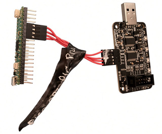
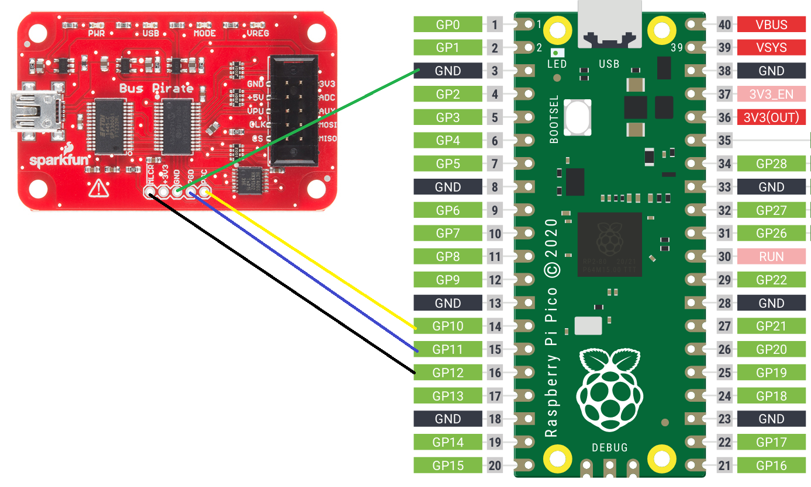
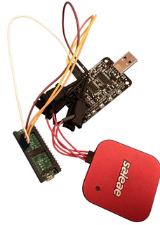

# bp3unbricker

bp3unbricker unbricks a Bus Pirate v3 with a Raspberry Pi Pico or Pico 2. The Pico connects to
the Bus Pirate's ICSP header, the programming port of its PIC24FJ64GA002 microcontroller (the
PIC). It writes the PIC's whole flash memory with the Pico's built-in image: bootloader v4.5 and
Community Firmware v7.1.12, the `BPCOMPBZ` build of
[buzzpirat](https://github.com/therealdreg/buzzpirat) made for original Bus Pirate v3 boards.
The PIC can be factory-blank, erased or corrupted. Before it reports success, the Pico reads
back all 22016 instructions (66048 bytes) and compares them. It needs no PICkit, MPLAB or
drivers: once the Pico is wired up, a one-second press of its BOOTSEL button does the rest.



With a computer, the Python script `bp3unbricker.py` turns the Pico into a full programmer for
the Bus Pirate v3. It writes any `.hex` file, such as another firmware version, an old official
release or your own build, and reads the chip back to save or verify it. It can also write only
the bootloader, so that buzzloader, buzzpirat's firmware loader, can load the firmware over USB.

## Contents

- [What you need](#what-you-need)
- [Wiring](#wiring)
- [Unbrick in 3 steps](#unbrick-in-3-steps)
- [Troubleshooting](#troubleshooting)
- [Using a computer](#using-a-computer)
  - [The Pico's console](#the-picos-console)
  - [Install bp3unbricker.py](#install-bp3unbrickerpy)
  - [Program any .hex file](#program-any-hex-file)
  - [Write only the bootloader, then use buzzloader](#write-only-the-bootloader-then-use-buzzloader)
  - [Update the Pico](#update-the-pico)
- [What protects the Bus Pirate](#what-protects-the-bus-pirate)
- [Results on the bench](#results-on-the-bench)
- [How it works](#how-it-works)
- [The Bus Pirate v3 bootloader and buzzloader](#the-bus-pirate-v3-bootloader-and-buzzloader)
- [For developers](#for-developers)
- [Reference documents](#reference-documents)
- [License](#license)

## What you need

- A Raspberry Pi Pico (RP2040) or Pico 2 (RP2350). The H versions are the same boards with
  headers. "Pico" means either board from here on.
- Four female-to-female jumper wires. Wires up to 25 cm work on both boards (see
  [Soak runs](#soak-runs)). Longer ones were not tested, and shorter ones give cleaner signals.
- Two USB cables: one for the Pico, and one to power the Bus Pirate from its own USB port.
- A computer, to copy one file to the Pico and to check the Bus Pirate afterwards. Unbricking
  itself needs no computer.

## Wiring



Four wires connect the Bus Pirate's ICSP header, JP2, to the Pico. The Pico 2 has the same
pinout.

| Bus Pirate JP2 pin | Signal | Pico pin | Wire in the diagram |
|---|---|---|---|
| 1 | PGC, clock (Pico to Bus Pirate) | 14 (GP10) | yellow |
| 2 | PGD, data (both ways) | 15 (GP11) | blue |
| 3 | GND | 3, or any other GND pin (8, 13, 18, ...) | green |
| 4 | 3V3 | none, leave it unconnected | none |
| 5 | MCLR, reset (Pico to Bus Pirate) | 16 (GP12) | black |

**Do not connect 3V3.** The Bus Pirate runs from its own USB cable, and the Pico does not power
it through the signal lines (see [What protects the Bus Pirate](#what-protects-the-bus-pirate)).

Never leave an unpowered Pico wired to a powered Bus Pirate: the Pico's pins would pull MCLR
down and keep the Bus Pirate in reset.

## Unbrick in 3 steps

1. Install bp3unbricker on the Pico. Download the file for your board from the
   [latest release](https://github.com/therealdreg/bp3unbricker/releases/latest). Hold the
   Pico's BOOTSEL button while you plug it into a computer, then release it. Copy the file to
   the drive that appears:

   | Board | File | Drive |
   |---|---|---|
   | Pico (RP2040) | [`bp3unbricker-pico.uf2`](https://github.com/therealdreg/bp3unbricker/releases/latest/download/bp3unbricker-pico.uf2) | `RPI-RP2` |
   | Pico 2 (RP2350) | [`bp3unbricker-pico2.uf2`](https://github.com/therealdreg/bp3unbricker/releases/latest/download/bp3unbricker-pico2.uf2) | `RP2350` |

   A file for the wrong board is ignored and the drive stays open, so copy the other file.
   [`SHA256SUMS.txt`](https://github.com/therealdreg/bp3unbricker/releases/latest/download/SHA256SUMS.txt)
   holds the SHA-256 of both UF2 files.

2. Wire the Pico as shown in [Wiring](#wiring). Power it from the computer or a USB charger,
   then plug in the Bus Pirate's USB cable.

3. With the Pico running, hold its BOOTSEL button until the LED starts blinking fast, then let
   go. You can also type `flash` in the [Pico's console](#the-picos-console).

| Pico LED | Meaning |
|---|---|
| A short blink every second | Ready. |
| On while you hold BOOTSEL | Keep holding. Programming starts after one second. |
| Fast blinking | Working, for about 23 s. |
| Steady on | The last operation succeeded. After BOOTSEL or `flash`, the Bus Pirate runs the new firmware. After `erase`, `blank`, `bootloader` or `jumper`, no firmware runs. |
| 1 to 6 blinks, a pause, repeated | An error. The number of blinks tells which (see [Troubleshooting](#troubleshooting)). |

When the LED stays on, remove the wires: the Bus Pirate is ready. To check it, open its own
serial port, not the Pico's, at 115200 baud (see [Using a computer](#using-a-computer) to tell
the two apart). Type `i` and press Enter. The Bus Pirate answers:

```
Bus Pirate v3.5
Community Firmware v7.1 - buzzpirat.com by Dreg BPCOMP TWELVE [...] Bootloader v4.5
```

The Pico keeps the result and the last 16 KB of the run's output, even after a BOOTSEL run with
no terminal open. Open the [Pico's console](#the-picos-console) without unplugging the Pico: the
result follows the banner, and `log` prints the output. On a compatible board whose LED is not
on GP25, this is the only way to read the result.

## Troubleshooting

| LED | Console message | Cause and what to do |
|---|---|---|
| 1 blink | `no target` | The Bus Pirate has no power, MCLR or GND is not wired, or another programmer holds MCLR low. The console also says whether the MCLR wire is open or on another Pico pin. |
| 2 blinks | `MCLR/PGC/PGD do not follow the programmer` | A short circuit, or a PICkit still connected and driving the lines. |
| 3 blinks | `the PIC does not answer over ICSP`, `wrong or missing device ID` | PGC and PGD swapped or not connected, or not a Bus Pirate v3. |
| 4 blinks | `flash operation timed out`, `flash operation failed (WRERR)`, `chip is not blank` | The erase or a write failed. Check the wires and the Bus Pirate's power. After `blank`, it only means the PIC is not erased. |
| 5 blinks | `verify failed` | After a flash, all 3 attempts failed: bad wiring or contacts, or a damaged PIC. Use shorter wires, or try again after `speed slow` in the console. After `verify`, the PIC differs from the image. |
| 6 blinks | `image is corrupt` | A corrupt built-in image means the Pico's flash memory is damaged: copy the UF2 file again ([step 1](#unbrick-in-3-steps)). A corrupt uploaded image changed in the Pico's RAM: send it again. |

- If the computer loses the Pico or the serial port times out, check the USB setup in
  [Using a computer](#using-a-computer).
- After a PICkit or MPLAB session, the Bus Pirate may stay in its bootloader, with its MODE LED
  on, because the PICkit keeps PGC low. Disconnect the PICkit and replug the Bus Pirate, or send
  it the byte 0xE4 through its serial port with `python bp3unbricker.py bp PORT boot`.

### Held in reset after a failed write

After a failed write, the Pico holds the PIC in reset so it cannot run a half-written flash. The
console prints `The PIC is held in reset. Fix the problem and run the command again.` Then
`status` shows `Bus Pirate: not checked, MCLR held low after a failed write (until 'release')`.

The next command that uses the PIC ends the hold, and so do `release`, `raw exit` and
`raw release`. `status`, `pins` and `bench` leave it in place. After `release`, or after a
command that only reads (`id`, `verify`, `blank`, `dump`, `ping`), the PIC runs whatever its
flash memory holds, even half-written firmware.

Two other messages can follow a failed write:

- `The PIC could not be held in reset: something else drives MCLR.` A short or another
  programmer keeps MCLR high 1 ms after the Pico drives it low, so the Pico lets go instead of
  fighting it.
- `MCLR is held low: the PIC stays in reset if the MCLR wire is connected.` The last attempt
  found no target, because the power went or the MCLR wire came loose.

## Using a computer

Plug the Pico and the Bus Pirate straight into the computer with short USB cables, not through a
hub. Run the terminal and `bp3unbricker.py` on the computer's own operating system. USB passed
through to a virtual machine can drop or slow down the serial port, and lose the Pico while it
reboots, for example during `install`.

Each board shows up as its own serial port: `COM3` or similar in the Windows Device Manager, and
on Linux usually `/dev/ttyACM0` for the Pico and `/dev/ttyUSB0` for the Bus Pirate. To tell them
apart, unplug one board and see which port goes away. Close any terminal on a port before the
script or buzzloader uses it.

### The Pico's console

Open the Pico's port in any terminal, such as PuTTY, Tera Term, `screen` or the Arduino serial
monitor, with any line ending (CR, LF or both). The terminal must raise DTR, as most do, or the
Pico sends nothing. Any baud rate works except 1200, which reboots the Pico into BOOTSEL mode.

When a terminal opens the port, the Pico prints a banner with its version, board, chip revision,
project link, license and author. The wiring, the images it holds and the last result follow,
then the `>` prompt. After a reconnect or a BOOTSEL run, the Pico drops a half-typed command.

| Command | What it does |
|---|---|
| `flash` | Erase the PIC, check that it is blank, write the built-in image, verify every word and let the Bus Pirate run. |
| `verify` | Compare the PIC with the built-in image, or with the uploaded one for `verify loaded`. |
| `id` | Show the device ID, silicon revision, configuration words and calibration words. |
| `blank` | Check that the PIC is erased. |
| `status` | Show the wiring, the clock, whether the Bus Pirate is detected and the last result. It keeps and reports a `jumper` or a [hold in reset](#held-in-reset-after-a-failed-write). |
| `pins` | Show which free Pico pins see an external pull-up, and the levels of PGC, PGD and MCLR. A line the Pico holds low (PGC after `jumper`, MCLR after a failed write) shows as held. |
| `log` | Print the output of the last operation again. |
| `release` | Release the lines and let the Bus Pirate run. It reports a missing target, such as a Bus Pirate without power. |
| `erase` | Erase the PIC, which leaves the Bus Pirate without firmware. |
| `dump` | Read the whole PIC and print it as Intel HEX, in MPLAB IPE's layout. |
| `test [seed]` | Run a self-test: erase, write and verify the whole flash twice, with random words and then all zeros, keeping the configuration words safe. A final `flash` writes the built-in image back. |
| `speed slow\|normal\|fast` | Set the PGC clock to ~240 kHz, ~850 kHz (the default) or ~1.5 MHz (~1.75 MHz on the Pico 2), until the next `speed` or a restart. |
| `bootloader` | Write only the bootloader of the built-in image (see [Write only the bootloader](#write-only-the-bootloader-then-use-buzzloader)). |
| `jumper` | Hold PGC low, as the PGC-PGD jumper does, and restart the Bus Pirate. Its bootloader then waits for buzzloader until `release` or the next operation. |
| `load [name]` | Receive an image from `bp3unbricker.py` (see [The upload protocol](#the-upload-protocol)). |
| `flash loaded` | Write the uploaded image as `flash` writes the built-in one. `bp3unbricker.py flash FILE.hex` uploads the file and runs this. |
| `bootsel` | Reboot the Pico into BOOTSEL mode. |
| `help` | List the commands. |

`help` also lists bring-up helpers that are not needed to unbrick: `ping`, `bench`, `entry`,
`pgdpull` and `raw` (see [Console bring-up helpers](#console-bring-up-helpers)).

### Install bp3unbricker.py

`bp3unbricker.py` is one Python file for Windows, Linux and macOS. It needs Python 3.8 or later
and pyserial (`pip install pyserial`). The "Source code (zip)" of the
[latest release](https://github.com/therealdreg/bp3unbricker/releases/latest) holds the script
and the matching `bp3unbricker.c`, which `bootloader` needs beside the script. Unzip it and open
a command prompt in the unzipped folder.

The script finds the Pico by itself. With more than one Raspberry Pi serial device, such as a
second Pico or a Debug Probe, choose the Pico's port with `--port`. On Linux, you may have to
join the `dialout` group to open the ports.

Every command starts with `python bp3unbricker.py` (`python3` on Linux and macOS):

| Command | What it does |
|---|---|
| `info FILE.hex` | Check a `.hex` file. No Pico needed. |
| `flash FILE.hex` | Upload the file, then erase, program, verify, read the whole PIC back and let the Bus Pirate run. |
| `flash` | Write the built-in image, as BOOTSEL does. |
| `verify [FILE.hex]` | Compare the whole PIC with the file, or with the built-in image when FILE is left out. |
| `read backup.hex` | Save the whole PIC as Intel HEX, in the MPLAB layout. |
| `bootloader` | Write only the bootloader of the built-in image, then read the whole PIC back. |
| `jumper`, `id`, `blank`, `erase`, `status`, `log`, `release` | Run the console command of the same name. |
| `run "COMMAND"` | Run one console command, in printable ASCII only, so a line break cannot add a second one. |
| `term` | Open an interactive console. Ctrl+C quits. |
| `install FILE.uf2` | Copy a release's UF2 file to the Pico (see [Update the Pico](#update-the-pico)). |
| `bp PORT info\|hello\|boot\|raw TEXT` | Talk to the Bus Pirate's own serial port. `info` sends the firmware's `i` command, `hello` the bootloader's HELLO, `boot` the byte 0xE4 that leaves the bootloader, and `raw` any text. |

`--port` and `--speed slow|normal|fast` go before the command, as in
`python bp3unbricker.py --speed slow flash FILE.hex`. `--speed` sets the PGC clock for that run
and leaves the Pico at `normal` afterwards.

For these commands, the exit status is 0 on success, 1 when the operation fails and 2 for a bad
`.hex` file or bad arguments. `--help` lists every command,
[the developer ones](#for-developers) included, and `--version` prints the version.

### Program any .hex file

These examples use files from buzzpirat's
[`bin/oldfirm/`](https://github.com/therealdreg/buzzpirat/tree/main/bin/oldfirm) folder, copied
next to the script. In `cmd.exe`, leave out the `# ...` comments:

```
python bp3unbricker.py flash BPv3-firmware-v7.1_Dreg-and-Bootloader-v4.5-Aug-2023_Dreg.hex
python bp3unbricker.py flash --add-config BPv3-frimware-v6.1.hex     # official v6.1, no bootloader
python bp3unbricker.py flash                                         # back to BPCOMPBZ v7.1.12
```

The BOOTSEL button always writes the built-in image, never an uploaded one.

Bus Pirate firmware does not run with the PIC's configuration words erased, so `flash` refuses a
file without them. For such a file, `--add-config` adds the Bus Pirate v3 values (CW2=0xF9DF
CW1=0x3F7F), and `--no-config` leaves them erased. Neither option changes a file that has its
own words. Configuration words that would leave the Bus Pirate unusable need `--force`: code
protection, write protection, debug mode, JTAG, a reserved value, or WINDIS=0 without FWDTEN=1.

A file without a bootloader in 0x00A800-0x00ABFB is written as it is, with a note. The firmware
then runs, but cannot be updated over USB until a bootloader is written again.

`bp3unbricker.py` and the Pico check the data at each stage:

| Stage | Checks |
|---|---|
| Reading the `.hex` | Every record checksum, an end-of-file record (so a truncated file is refused), no byte given twice with different values, nothing outside the program flash (0x000000-0x00ABFE), and whole PIC24 instructions whose phantom byte, the unused fourth byte, is zero. |
| Computer to Pico | Each 64-word row carries its row number and a CRC-32 and must be acknowledged. A refused row is sent up to 3 times. The CRC-32 of the whole image must match before the Pico accepts it, and a wrong CRC, an abort or a silent computer leaves no usable image. |
| Pico to PIC | Erase, blank check, programming and verification of all 22016 words, with the checks of [What protects the Bus Pirate](#what-protects-the-bus-pirate). |
| Final read-back | The script reads all 22016 words back (record checksums and the CRC-32 of the read) and compares them with the `.hex` file itself. `--no-readback` skips this step. |

### Write only the bootloader, then use buzzloader

Get [buzzloader](https://github.com/therealdreg/buzzpirat/tree/main/bin/buzzloader) from
buzzpirat, then:

1. Run `python bp3unbricker.py bootloader`, or type `bootloader` in the console. The Bus Pirate
   now holds only the bootloader and prints nothing on its serial port (see
   [How the ds30 bootloader v4.5 behaves](#how-the-ds30-bootloader-v45-behaves)).
2. Run `python bp3unbricker.py jumper`, or type `jumper` in the console. The Bus Pirate waits in
   its bootloader with the MODE LED on. A PGC-PGD jumper on JP2 does the same without the Pico.
3. Run `buzzloader --dev=PORT --hex=BPCOMPBZ-firmware-v7.1.12.hex`, where PORT is the Bus
   Pirate's serial port. The file is in buzzpirat's `bin/stablefirm/bpv3comp/` folder. Any of
   the 11 firmware-only files tested in
   [Bootloader and buzzloader cycles](#bootloader-and-buzzloader-cycles) works. With a v7.1
   file, buzzloader ends with an error, which is expected.
4. Run `python bp3unbricker.py release`, or remove the jumper and replug the Bus Pirate. The
   bootloader then starts the firmware.

That error comes at the bootloader's page: after the file's other pages, buzzloader stops with
`Erasing page 42, a800...ERROR [50]` and `Error updating firmware :(` (see
[buzzloader 3.0](#buzzloader-30) for why). The firmware is complete anyway. After buzzloader
writes `BPCOMPBZ-firmware-v7.1.12.hex`, the PIC holds word for word the image that `flash`
writes. With the v5.x and v6.x files, which have no configuration words, buzzloader ends with
`Firmware updated successfully :)!`.

`bootloader` writes the same bootloader v4.5 as `flash`, word for word: the reset
`GOTO 0x00A800` and the page 0x00A800-0x00ABFE, with the bootloader's code, its version word and
the configuration words. All other words are erased and verified as erased, including the
bootloader's jump to the firmware at 0x00A7FC. It takes the same steps as `flash`, from the CRC
check to the verify of all 22016 words, and retries if needed.

From the computer, `bootloader` then reads the whole PIC back and checks for the 228 words of
the bootloader and 21788 erased words. It writes nothing unless the `bp3unbricker.c` beside the
script holds the Pico's built-in image, or `--no-readback` skips that check.

### Update the Pico

Download the new UF2 file from the
[latest release](https://github.com/therealdreg/bp3unbricker/releases/latest). Without Python,
copy it as in [step 1](#unbrick-in-3-steps). With Python, run `install`:

```
python bp3unbricker.py install bp3unbricker-pico.uf2      # or bp3unbricker-pico2.uf2
```

If the Pico runs bp3unbricker, `install` first reboots it into BOOTSEL mode by opening its
serial port at 1200 baud. Otherwise, start it in BOOTSEL mode as in step 1.

`install` refuses a file for the other chip. Given a folder, it takes the one UF2 file there for
the Pico's chip. Without an argument, it uses `dist/`, which `build` writes.

## What protects the Bus Pirate

- The Pico does not power the Bus Pirate through its pins, except with the bring-up commands
  `pgdpull up` and `raw` (see [Console bring-up helpers](#console-bring-up-helpers)). It drives
  no line high until MCLR has floated high through the Bus Pirate's 2 kOhm pull-up, and stops
  with `no target` if MCLR stays low. Every flash attempt starts with this check, so a retry
  after a failed write releases MCLR for about 2.2 ms. Holding a PIC in reset needs no check,
  because it only drives lines low.
- With the PIC in reset, MCLR, PGC and PGD must read back what the Pico drives. This line check
  catches shorts and a second programmer that still drives the lines.
- The device check accepts only a PIC24FJ64GA002. The PIC must echo two test patterns through
  VISI, then DEVID must read 0x0447.
- The executive memory, with the FRC calibration word that the Bus Pirate's UART depends on, is
  never erased or written. The chip erase selects user memory only, and the calibration words
  are only read.
- All 22016 words are verified, the configuration words included. The verify masks the bits that
  [never read back as written](#what-the-programming-specification-does-not-say): the
  unimplemented upper byte of both configuration words, and the reserved CW1 bit 15 ("program as
  0").
- A failed attempt is retried twice, at half and then a quarter of the clock speed. No target, a
  line fault, a wrong device ID and a corrupt image fail at once, because a retry cannot fix
  them.
- Once a flash attempt has started to erase, any later failure
  [holds the PIC in reset](#held-in-reset-after-a-failed-write) as soon as the Pico sees it,
  even in a retry that cannot open its session. The Pico keeps MCLR driven low, and drives PGC
  and PGD low for 1 ms before it releases them. A failed `erase`, a failed `test` pass and the
  flash that ends `test` do the same. A flash that fails before the erase releases the Bus
  Pirate as usual, and the console adds `Nothing was written.` after a line fault or when the
  PIC does not answer.
- The built-in image carries a CRC-32 that the Pico checks at boot. Every image, built in or
  uploaded, is checked again before each attempt and after writing. An image that changed in RAM
  is not tried again, and the PIC stays in reset.
- The Pico releases PGC without a pull-down, because the v4.5 bootloader reads a low PGC as its
  "stay in bootloader" jumper. A released Bus Pirate boots straight into its firmware.

## Results on the bench

All results come from this bench:

- A Bus Pirate v3.5 with a PIC24FJ64GA002 rev B8
- A Raspberry Pi Pico (RP2040 B2) and a Pico 2-compatible board (RP2350 A4)
- 25 cm Dupont wires, except in results marked "short wires"
- A Saleae Logic Pro 8 on the ICSP header, and a PICkit 4 for the reference reads



### Unbricking

Times are for bp3unbricker 1.3.2 unless a cell names another version. On the Pico, 1.3.1 gave
the same times.

| Operation | Pico (RP2040) | Pico 2 (RP2350) |
|---|---|---|
| `flash` (the Bus Pirate then boots) | 22.9 s (erase 0.2 s, blank check 8 s, 323 rows written in 6.7 s, verify 8 s) | 20.7 s (erase 0.2 s, blank check 7.2 s, 323 rows written in 6.1 s, verify 7.2 s) |
| `flash` at `speed fast` | 11.9 s | 9.8 s |
| `verify` at slow / normal / fast | 26.4 / 8.0 / 4.1 s | 26.0 / 7.2 / 3.3 s |
| `test` | 69.5 s (36.2 s at `speed fast`) | 62.8 s (29.6 s at `speed fast`) |
| `dump` | Byte-identical to the PICkit 4's read after it wrote the built-in image, crc32 23632567 (earlier versions) | Byte-identical to the Pico's dump (1.2.1/1.3.0) |
| BOOTSEL held 1 s, no terminal open | OK in 22.8 s (earlier versions) | OK in 20.9 s (1.2.1/1.3.0) |
| `bootloader` (6 rows) | 16.4 s (1.3.1) | 14.7 s |
| Executive memory and FRC calibration after every erase and flash | Unchanged | Unchanged (1.2.1/1.3.0) |

### Programming from a computer

- `bp3unbricker.py flash FILE.hex` took 36 s on the Pico (upload 1.5 s, read-back 11.5 s) and
  33 s on the Pico 2 (upload 1 s, read-back 9 s). It wrote and read back another v7.1 (Dreg, Aug
  2023), BPCOMPBZ, the official v6.1 (with `--add-config`) and an all-rows random image.
- `verify FILE.hex` with a different file reported 19643 differing words, the same count as the
  Pico's own `verify`, and exited with status 1.
- `read` saved a file whose crc32 matched the written file's.
- `test-loader` passed all 22 upload checks on both boards (see [Tests](#tests)).

### Soak runs

A 90-minute run on each board, with 25 cm wires, had no error and no retry, nor did three
shorter runs of later versions. Nothing is simulated, and the Saleae stays clipped on.

Each round runs one operation at one PGC speed, in rotation: the Pico's self-test, the built-in
image, a random image on all 344 rows, one of the 18 valid buzzpirat `.hex` files or three full
reads. After each round, `id` must pass with the calibration words unchanged, and in the 1.3.2
runs with the same DEVID and DEVREV.

| Run | Rounds | Chip erases (flashes and self-test passes) | Full reads on the computer | Uploads over USB | Firmware boots checked on the Bus Pirate's serial port |
|---|---|---|---|---|---|
| 1.2.1, Pico, 90 min | 104 | 112 | 152 (3.35 M words) | 48 (14431 rows) | 20 |
| 1.2.1, Pico 2, 90 min | 114 | 124 | 166 (3.65 M words) | 52 (15783 rows) | 22 |
| 1.3.1, Pico, 30 min | 37 | 41 | 53 (1.17 M words) | 17 | 8 |
| 1.3.2, Pico, 10 min | 12 | 14 | 16 (0.35 M words) | 6 | 3 |
| 1.3.2, Pico 2 with short wires, 10 min | 15 | 18 | 21 (0.46 M words) | 6 | 3 |

The PIC is rated for at least 10000 erase cycles (DS39881, D130).

In 90 minutes, the Pico wrote 35775 rows (2.29 M words) and read 4.93 M words in blank checks
and verifies. The Pico 2 wrote 39795 rows (2.55 M words) and read 5.46 M words. With the full
reads, the two runs read 417 M bits (17.4 M words) without a single bit error. If errors were
independent, the bit error rate would be below 7.2e-9 (95%, rule of three).

An error would have shown up as a retry, a failed verify or a resent row, and none happened. The
round times agree: they stayed within 0.1 s for each operation, speed and file, and a retry
would have added a slower attempt.

### Bootloader and buzzloader cycles

For each of the 11 firmware-only `.hex` files of buzzpirat, `test-bootloader` runs this cycle:

1. `bootloader` writes the bootloader, and a full read-back must show nothing else.
2. The Bus Pirate's serial port must stay silent.
3. After `jumper`, `buzzloader --hello` must find the bootloader.
4. buzzloader writes the firmware.
5. After `release`, the firmware must answer on that port.
6. A full read-back must equal what the bootloader and buzzloader should leave, as computed from
   `buzzloader.c`.
7. `id` must show DEVID, DEVREV and the calibration words unchanged.

| Run | Cycles passed | Checks passed |
|---|---|---|
| 1.3.0, Pico, two rounds | 22/22 | 232/232 |
| 1.3.1, Pico | 11/11 | 121/121 |
| 1.3.2, Pico | 11/11 | 121/121 |
| 1.3.2, Pico 2 with short wires | 11/11 | 121/121 |

In the 1.3.2 runs, timed from the computer, `bootloader` took 16.6 s on the Pico and 15.0 s on
the Pico 2, buzzloader 11.5 to 13.9 s, and a whole cycle about 1 minute.

| File | buzzloader | Bus Pirate after `release` |
|---|---|---|
| `BPCOMPBZ-firmware-v7.1.12.hex` | 41 pages, then `ERROR [50]` at page 42 | `Community Firmware v7.1 - buzzpirat.com by Dreg BPCOMP TWELVE [...] Bootloader v4.5` |
| `BZ-firmware-v7.1.12.hex` | 41 pages, then `ERROR [50]` | `Community Firmware v7.1 - buzzpirat.com by Dreg BZ TWELVE [...]` |
| `BPv3-firmware-v7.1-Aug-2023_Dreg.hex` | 38 pages, then `ERROR [50]` | `Community Firmware v7.1 - build by Dreg Aug two thousand twenty-three buzzpirat dot com [...]` |
| `BPv3-firmware-v7.1-JTAG_SAFE_1_Aug-2023_USBEprom.hex` | 36 pages, then `ERROR [50]` | `Community Firmware v7.1 - goo.gl/gCzQnW [...]` |
| `BPv3-frimware-v6.1.hex` | 42 pages, success | `Firmware v6.1 r1676  Bootloader v4.5` |
| `BPv3-firmware-v6.3-r2151.hex` | 42 pages, success | `Firmware v6.3-beta1 r2151  Bootloader v4.5` |
| `BPv3-firmware-v6.2-r1981.hex` | 42 pages, success | `Firmware v6.2-beta1 r1981  Bootloader v4.5` |
| `BPv3-Firmware-v5.10.hex` | 42 pages, success | `Firmware v5.10 (r559)  Bootloader v4.5` |
| `BPv3-Firmware-v5.9.hex` | 42 pages, success | `Firmware v5.9 (r539)  Bootloader v4.5` |
| `BPv3-Firmware-v5.9-extras.hex` | 42 pages, success | `Firmware v5.9 (r529) [HiZ 2WIRE 3WIRE KEYB LCD DIO] Bootloader v4.5` |
| `BPv3-Firmware-v5.5.hex` | 42 pages, success | `Firmware v5.5 (r457) Bootloader v4.5` |

### Signal integrity

A Saleae capture of `id` at 500 MS/s decodes cleanly on both boards: 4177 clocks, 130 SIX and 19
REGOUT commands, no leftover bits. PGD never changes while PGC is high, and no glitch shows at
2 ns resolution.

PGC timing at `speed normal`, against a specified minimum of 40 ns per phase:

| Board and version | PGC high, min / median | PGC low, min / median | PGD set before PGC rises, min |
|---|---|---|---|
| Pico, 1.3.1 and 1.3.2 | 510 / 536 ns | 536 / 672 ns | 512 ns |
| Pico, 1.3.0 | 534 / 536 ns | 640 / 720 ns | 544 ns |
| Pico 2, 1.3.2 | 498 / 546 ns | 500 / 586 ns | 514 ns |
| Pico 2, 1.2.1 | 492 / 546 ns | 546 / 614 ns | 494 ns |

An analog capture of `id` at 50 MS/s with 1.3.2, decoded clock by clock with `pgd-levels`, shows
PGD on the latched bits. PGD is a Schmitt-trigger input, and at VDD 3.3 V a 1 must be above 0.8
VDD (2.64 V) and a 0 below 0.2 VDD (0.66 V).

| PGD, a 1 / a 0 | Pico | Pico 2 |
|---|---|---|
| Sent by the Pico, at PGC rising (where the PIC latches) | 3.22 / 0.04 V | 3.26 / 0.04 V |
| Sent by the PIC, before PGC falls (where the Pico samples) | 3.23 / 0.05 V | 3.23 / 0.07 V |
| Anywhere in those clocks | 3.21 / 0.08 V | 3.23 / 0.15 V |

That leaves at least 0.5 V of margin on both sides. The only disturbances fall on clocks where
nobody reads PGD:

- During the 8 idle clocks of REGOUT, only a pull-down holds PGD. Each rising edge of PGC
  couples into it, by up to 0.47 V on the Pico and 0.66 V on the Pico 2 (0.35 V and 0.31 V with
  short wires).
- At the end of REGOUT, PGD floats briefly after its bit is sampled.

The Saleae's analog inputs have about 5 MHz of bandwidth and could miss spikes shorter than
about 100 ns, a gap that the error-free [soak runs](#soak-runs) cover.

## How it works

The Pico uses plain 2-wire ICSP, from section 3 of the programming specification (DS39768), not
Enhanced ICSP with Microchip's programming executive. A `SIX` command, a 4-bit code followed by
a 24-bit instruction, makes the PIC execute that instruction, and `REGOUT` shifts out the VISI
register. Bits go least significant first and are latched on the rising edges of PGC.

The Pico bit-bangs PGC and PGD with code that accesses the SIO registers inline, runs from RAM
and times each phase with SysTick. On the RP2040, function calls and XIP cache misses would
otherwise cost about 400 ns per PGC phase. A request for 500 ns per phase gives a real 536 ns
high and 672 ns low (medians). The same code runs on the RP2040 (Cortex-M0+, 125 MHz) and the
RP2350 (Cortex-M33, 150 MHz), with delays computed from the system clock.

The PIC reads and writes its flash through `TBLRD` and `TBLWT` instructions sent one by one. It
writes one row of 64 instructions at a time (`NVMCON=0x4001`), and the chip erase clears user
memory only (`NVMCON=0x404F`, TBLPAG = 0). The configuration words go inside the last row, as
the PICkit 4 writes them.

The timing follows DS39768:

| Parameter | Value |
|---|---|
| PGC period and phases | P1 >= 100 ns (PGC <= 10 MHz), P1A/P1B >= 40 ns |
| Setup and hold | P2/P3 >= 15 ns |
| Entry | P18 >= 40 ns, P19 >= 1 ms (1.5 ms used), P7 >= 25 ms (30 ms used) |
| Erase and write | Chip erase P11 >= 400 ms. The Pico polls WR, and the erase took 211 ms. Row write P13 >= 2 ms. |

No word is written twice between erases, and the PC is parked at 0x200 regularly, because it
keeps incrementing in ICSP mode.

### The PIC24FJ64GA002 on the Bus Pirate v3

| Item | Value |
|---|---|
| Device | PIC24FJ64GA002, DEVID 0x0447 at 0xFF0000 |
| Silicon | DEVREV 0x3046 (B8) at 0xFF0002 |
| User flash | PC 0x000000-0x00ABFE: 22016 instructions, in 344 rows of 64 or 43 pages of 512 |
| Configuration words | CW2 at 0xABFC = 0xF9DF, CW1 at 0xABFE = 0x3F7F, inside the last row (0xAB80-0xABFE) |
| Executive memory | 0x800000-0x8007FE, with the FRC calibration and diagnostic words at 0x8007F0-0x8007FE (`0000CB 000033 08F110 10007F FF0090 FF0001 FFFFFF 00F100` on the bench chip) |
| ICSP header JP2 | Microchip's order (MCLR, VDD, GND, PGD, PGC) numbered the other way round: pin 1 is PGC and pin 5 is MCLR |
| Board | MCLR has a 2.0 kOhm pull-up (R10) to 3V3, and PGC (RB1) and PGD (RB0) have nothing else on them. |

The buzzpirat images use this memory map:

| Address | Content |
|---|---|
| 0x000000 | Reset GOTO |
| 0x000004-0x0001FE | Vector tables |
| 0x000200-0x00A7FB | Firmware |
| 0x00A7FC | The bootloader's GOTO to the firmware |
| 0x00A800-0x00ABF7 | Bootloader |
| 0x00ABF8 | `bljump` |
| 0x00ABFA | Version word (0x0405) |

### What the programming specification does not say

These findings come from the bench, with a PICkit 4 and the Saleae.

The first instruction after the forced 9-bit SIX is discarded, but it still advances the PC. The
PIC leaves ICSP as soon as the PC reaches the interrupt vector table at 0x0004, so exactly one
instruction may come before `GOTO 0x200`. `NOP, GOTO 0x200, NOP` works, as in every DS39768
table, and so does the PICkit 4's `GOTO, GOTO, NOP`. With `NOP, NOP, GOTO` or `GOTO, NOP, NOP`,
REGOUT returns 0x0000. The VISI echo of each sequence:

| Instructions after the key | VISI echo |
|---|---|
| NOP, GOTO, GOTO, NOP | A55A |
| GOTO, GOTO, NOP | A55A |
| NOP, GOTO, NOP | A55A |
| GOTO, NOP | 0000 |
| GOTO, NOP, NOP, GOTO, NOP | 0000 |

A rising edge on PGC while MCLR is low, before the key, is clocked into the key receiver. The
Pico never raises PGC before the key.

CW1 bit 15 reads 0 even on a blank chip, where CW1 reads 0x7FFF (DS39768 Table 3-6). The upper
byte of the configuration words always reads 0xFF.

There is no contention at the REGOUT turnaround. The PIC starts driving PGD 20 to 30 ns after
the falling edge of the 8th idle clock, and releases it on the falling edge of the 16th data
clock. The Pico lets go of PGD before the idle clocks and drives it again half a PGC low phase
after that edge (250 ns at `speed normal`).

When the bootloader runs with PGC low, it drives RB0 (PGD) low and keeps it there, so a REGOUT
reads 0x0000 even with a pull-up on PGD.

DS39768 Table 3-9 prints `MOV <CW2Address15:0>, W6` with the opcode `2xxxx7`, which loads W7.
The picberry programmer copies this erratum and reads the configuration words from the wrong
address.

Nothing in the silicon errata (DS80000470J) affects 2-wire ICSP on B8 silicon. Erratum 23
concerns ICSP over JTAG, on A3 and A4 silicon only.

### What the PICkit 4 does

Decoded from Saleae captures of a PICkit 4 running MPLAB IPE 6.35:

- On entry, it pulses MCLR high for 13.85 us and sends the key about 100 us later. It raises
  MCLR 1.0 ms after the key (P19) and sends the first command 25 ms later (P7).
- It uses the same plain ICSP chip erase as the Pico and polls NVMCON, which reads 0xC04F while
  busy and 0x404F when done, after 211 ms.
- To read and program, it loads its programming executive into executive memory. It erases
  0x800000 and 0x800400 and restores the calibration row. It handles 0x0000-0xA7FE through the
  executive (EICSP key `0x4D434850`), and the last page over plain ICSP as 8 row writes.
- Its clock runs at about 1.6 MHz, with PGC high and low for about 300 ns each, and PGD changes
  while PGC is low, at least 110 ns before the rising edge.

A PICkit read of the bench Bus Pirate, as it came, gave exactly buzzpirat's
`BZ-pickit-firmware-v7.1.12-bootloader-v4.5.hex`. A random full-flash image written with IPE and
read back by the Pico matched in all 22016 words.

## The Bus Pirate v3 bootloader and buzzloader

### How the ds30 bootloader v4.5 behaves

These notes come from buzzpirat's `firmware/bootloader/ds30loader.s`, checked on the bench.

At reset, there are two ways into bootloader mode:

- The v7 firmware's `$` command writes a signature in RAM (0x27FC = 0x31415926) and a flag at
  0x27FA, then resets. If the bootloader finds both, it goes straight to bootloader mode.
- Otherwise it runs the jumper test. RB0 (PGD) is an output driven low, and RB1 (PGC) an input
  with a pull-up. If PGC reads low, the jumper is on and the bootloader enters bootloader mode.
  If it reads high, it jumps to the firmware through 0x00A7FC.

With no firmware, the erased word at 0x00A7FC executes as NOPR and runs into 0x00A800 again. The
bootloader loops through its jumper test and never opens the UART, so the Bus Pirate stays
silent.

In bootloader mode:

- The UART runs at 115200 baud.
- HELLO (0xC1) gets the answer `D4 01 02 'K'`.
- The byte 0xE4 starts the firmware, because the parser subtracts 0xC1 and then '#'.
- Every receive times out after 500 ms. The bootloader then stays while PGC is low and starts
  the firmware once it is high.
- After a HELLO it waits for a command, so a second HELLO within 500 ms is taken as an address
  byte.

The bootloader refuses any erase or write at a row address above 0xA7C0 and answers 'P', which
protects its own page 42. Row 0 always gets `GOTO 0xA800`.

`jumper` drives PGC low, pulses MCLR and lets it rise, so the bootloader sees its jumper.
`release` pulses MCLR with PGC floating, so the PIC's pull-up makes PGC read high and the
bootloader starts the firmware. Any other operation ends the jumper, because it opens an ICSP
session, and so do `ping`, `bench`, `raw enter`, `raw key`, `raw exit` and `raw release`.
`status` and `pins` keep it, and `status` only reads MCLR and adds a `Jumper:` line.

### buzzloader 3.0

buzzpirat's `bin/buzzloader` is built from `buzzloader.c`. It marks as used every 512-word page
that holds a data record of the file. It copies the file's reset GOTO to 0xA7FC and puts
`GOTO 0xA800` at 0x0000, then erases and writes every used page, all 8 rows, in ascending order.
At the end it does not send 0xE4, so the bootloader waits until the jumper is removed.

The v7.1 files carry the configuration words, which sit in the bootloader's page 42. The
bootloader refuses to erase that page, so buzzloader stops there with a non-zero exit status.

### Known issue in buzzpirat's combined .hex files

The bootloader in buzzpirat's combined files, the pickit files and every
`...and-Bootloader-v4.5` file, differs in two places from the standalone
`BPv3-Bootloader-v4.5_Dreg.hex`. The code from 0xA800 to 0xA98E is the same.

| | Standalone v4.5 | The combined files |
|---|---|---|
| `bljump` at 0xABF8 | `37FEC9`, a BRA 0xA98C to `firmwarejump` (`MOV #0xFFFF,W8`) | `37FEB8`, a BRA 0xA96A into the receive-timeout code (`BTSS W8,#0`). It is the v4.4 file's word (`:0857F000B8FE3700...`), whose shorter code had `firmwarejump` there. |
| 0xA990-0xA9BA | Erased | 22 words, the tail of the standalone `.hex` read as data: the `:0857F000C9FE...` payload, the record checksums D5, EB and FF, and the `0000FA` and `0001F9` address records |

bp3unbricker writes this bootloader word for word on purpose, because it is the bootloader these
files ship with. The 22 words never run: they follow `BRA setup`, and nothing jumps there.

`bljump` matters only to firmware that jumps to it with `MOV #0xABF8,W1` and `GOTO W1`, as the
v5.x and v6.x firmware and the bootloader upgrader from v4.x to v4.5 do. The v7.1.x firmware
does not, because its `$` uses the RAM signature. On this bootloader, the jump lands in the
timeout code, which enters bootloader mode if bit 0 of W8 is 1 or PGC reads low.

On the bench, `$` entered the bootloader 5 times out of 5 with both v6.1 and v7.1.12. The v6.1
firmware got there through the timeout code, where RB1 reads 0 because nothing pulls PGC up.
That is not the intended path. With PGC held high and bit 0 of W8 clear, the firmware would
restart instead.

## For developers

### Repository layout

| Path | What it holds |
|---|---|
| `bp3unbricker.c` | The whole firmware, plus the host tests (`-DBP3_HOST_TEST`) and the built-in image. |
| `bp3unbricker.py` | The whole computer side: programming, build, install, tools and tests. |
| `CMakeLists.txt`, `pico_sdk_import.cmake` | The Pico SDK build. |
| `dist/` | Not in git. `build` writes the two UF2 files and `SHA256SUMS.txt` here, and a [release](https://github.com/therealdreg/bp3unbricker/releases/latest) publishes them. |
| `build-pico/`, `build-pico2/`, `logs/` | Not in git. The build folders, and the logs of `test-bootloader` and `soak`. |
| `stuff/` | The built-in image's source `.hex`, the datasheets and the schematic (see [Reference documents](#reference-documents)). |
| `images/` | The two setup photos and the [Wiring](#wiring) diagram. |
| `README.md` | All the documentation. |

### Building

The build needs a Pico SDK 2.x. The Raspberry Pi Pico extension for VS Code installs the SDK,
the compiler, cmake and ninja in `~/.pico-sdk`.

```
python bp3unbricker.py build      # both boards -> dist/ + SHA256SUMS.txt
```

`build` takes the extension's newest cmake and ninja, by version number, or else those in PATH.
It builds both boards before it copies anything to `dist/`, so a failed build (exit status 1)
leaves `dist/` untouched. It checks that each UF2 file holds blocks for its own chip only:
family 0xE48BFF56 for the RP2040 and 0xE48BFF59 (RP2350 ARM secure) for the RP2350. The extra
0xE48BFF57 block is picotool's RP2350-E10 workaround.

To build one board by hand:

```
cmake -G Ninja -S . -B build-pico -DPICO_BOARD=pico      # Pico (RP2040)
cmake --build build-pico                                 # -> build-pico/bp3unbricker-pico.uf2
cmake -G Ninja -S . -B build-pico2 -DPICO_BOARD=pico2    # Pico 2 (RP2350)
cmake --build build-pico2                                # -> build-pico2/bp3unbricker-pico2.uf2
```

`BP3_VERSION` in `CMakeLists.txt` and `VERSION` in `bp3unbricker.py` must agree. The firmware's
banner and `status` show the first, with the board and the chip revision (`RP2040 B2`,
`RP2350 A4`). The script's banner and `--version` show the second. `build` stops before running
cmake while they differ, and `test-hex` checks them.

### The firmware source

`bp3unbricker.c` is one file in 12 sections:

| Section | What it holds |
|---|---|
| 1. configuration | The wiring (GP10, GP11, GP12). |
| 2. CRC-32 | IEEE 802.3, as in Python's `zlib.crc32`. |
| 3. images | `image_t` (22016 words of 3 bytes), its CRC-32 check, and `image_word()`, which reads a word. |
| 4. pins and delays | Inline SIO pin access and SysTick delays on the Pico. In the host tests, the simulator implements the same prototypes. |
| 5. ICSP | Key, entry, SIX, REGOUT and exit. `icsp_six` and `icsp_regout` live in RAM and are never inlined into flash code. |
| 6. PIC24 | The power and line checks, the VISI echo, the device ID, chip erase, row write (packed format, DS39768 Figure 3-6), reads through VISI, the hold in reset, release and `jumper`. |
| 7. operations | `flash`, `bootloader`, `verify`, `blank`, `erase`, `dump`, `test`, `id`, `jumper` and `release`, with retries and CRC checks. |
| 8. upload | The `load` protocol, and the 66 KB RAM buffer of the uploaded image. |
| 9. operation log | A 16 KB ring buffer, filled by a stdio driver while an operation runs. |
| 10. console | Commands, LED codes, the BOOTSEL button and `main()`. |
| 11. host tests | A pin-level PIC24FJ64GA002 simulator, a fake Pico SDK for sections 9 and 10, and every test case (`-DBP3_HOST_TEST` only). |
| 12. embedded image | Written by `hex2c`. |

`bootloader_image` is not a copy but the built-in image's own `data` with `bootloader_only` set,
for which `image_word()` returns 0xFFFFFF outside the reset GOTO and the page 0x00A800-0x00ABFE.
`ops_bootloader()` refuses any other source, even an identical copy elsewhere in memory. Its CRC
is computed over the words as `image_word()` gives them, as for every image.

PGD and MCLR have pull-downs of about 50 kOhm whenever the Pico does not drive them, so an open
wire reads low. PGC has no pull.

Two states outlast an operation: `jumper` leaves PGC driven low, and a failed write leaves MCLR
driven low. Section 6 records which one is in effect in a single `hold` state, because with two
flags GCC compiled `icsp_enter_key_only()` differently on the RP2040.

The BOOTSEL button is read by briefly turning the QSPI chip select into an input, as in
pico-examples. Its bit in SIO `gpio_hi_in` is 1 on the RP2040 and 27 on the RP2350.

### The upload protocol

`load` works one text line at a time, and every line gets one reply:

```
load name                         start -> "LOAD READY 344 64" (344 rows of 64 words)
R rrr wwwwww...wwwwww cccccccc    row rrr (3 hex digits), its 64 words (6 hex digits each)
                                  and the CRC-32 of those words, 3 bytes little-endian each
                                  -> "OK rrr", or "ERR rrr <reason>": send the row again
E cccccccc                        end: CRC-32 of the whole 22016-word image
                                  -> "LOAD OK <name> crc32 X, N rows used" or "LOAD ERR ..."
                                  ("ERR END format" for a malformed end line: the upload goes on)
X                                 abort -> "LOAD ABORTED"
any other line                    -> "ERR ??? format": the upload goes on
```

Unsent rows stay erased (0xFFFFFF), and a row may be sent again. A row's CRC does not cover its
number rrr, but the final CRC over every word catches a missing or misnumbered row before the
image can be used. After 10 s without a complete line, the upload ends with `LOAD ERR timeout`.

The console echoes the `load` line before it replies. End that line with CR or LF, not both,
because the LF of a CR LF arrives as an empty line and gets `ERR ??? format`. Later lines are
not echoed and end with LF, and a CR in them is ignored.

### Console bring-up helpers

| Command | What it does |
|---|---|
| `ping` | Enter ICSP and run a VISI echo test. The PIC runs again afterwards. |
| `bench` | Time the delay and GPIO routines. The PGC high-low pair is timed with the pin's output off, so nothing is driven. |
| `entry [P19 P7 PAUSE]` | Show the ICSP entry delays, or set all three, in us. |
| `pgdpull [up\|none\|down]` | Set the pull on PGD while the Pico does not drive it, `down` by default, until the next `pgdpull` or a restart. With `up`, an unpowered Bus Pirate gets a few tens of uA through PGD. |
| `raw enter\|key\|six HEX\|regout\|echo\|exit\|release` | Run one ICSP step at a time. `raw enter` and `raw key` check the power first. `raw six`, `raw echo` and `raw regout` need MCLR to read high, after `raw enter` or on a powered, released Bus Pirate, and otherwise print `ERROR: MCLR is low: run 'raw enter' first (or the Bus Pirate has no power)`. After `raw enter`, the Pico drives MCLR high, so they work even if the Bus Pirate loses power. `raw exit` and `raw release` drive nothing high. |

### Developer commands

The script also has these developer commands:

| Command | What it does |
|---|---|
| `build` | Build both UF2 files (see [Building](#building)). |
| `hex2c FILE.hex [--source FILE.c]` | Make FILE the built-in image (see [Changing the built-in image](#changing-the-built-in-image)). |
| `make-test-image OUT.hex [--seed N] [--pattern random\|zeros\|ones]` | Write a full-flash test image. With `random` and `zeros`, the configuration words are chosen so the chip stays readable over ICSP and `flash` takes the image. `ones` is an erased chip, configuration words included, so `flash` needs `--force` for it, as `make-test-image` warns. |
| `sniff --out DIR [--map MAP] [--rate HZ] [--analog-rate HZ] [--saleae-port PORT] -- COMMAND...` | Capture the ICSP lines with a Saleae Logic 2 while COMMAND runs, and export CSV. |
| `sniff-analog --out DIR [--map MAP] [--analog CH...] [--rate HZ] [--analog-rate HZ] [--after S] [--saleae-port PORT] -- COMMAND...` | Capture digital and analog data (MCLR, PGD and PGC by default), triggered on MCLR rising, as a Saleae binary export. |
| `decode CAPTURE.csv [--map MAP] [--list N] [--tail N] [--timing] [--dump-reads F] [--dump-writes F]` | Decode the ICSP traffic: sessions, SIX and REGOUT, a disassembly, and a symbolic emulation that turns reads and row writes back into memory contents. `--timing` measures PGC and PGD inside the ICSP sessions, and in the EICSP sessions of a PICkit. |
| `pgd-levels DIR [--map MAP]` | Measure PGD at every latched bit of a `sniff-analog` capture of MCLR, PGD and PGC, within 40 ns (at least one sample) of the PGC edge that latches the bit, at any analog rate. |
| `test-sim`, `test-hex`, `test-cli`, `test-loader`, `test-bootloader`, `soak` | Run the tests (see [Tests](#tests)). |

Like the Pico's console, the script first prints the project banner, with its own name and
version, on stderr only. It skips it for `--help`, `--version` and usage errors, and when stderr
is redirected or captured, as in scripts or under `sniff`.

### Saleae captures

`decode` and `pgd-levels` need numpy, and `sniff` and `sniff-analog` need logic2-automation.
Logic 2 must be open, with its automation server on port 10430 or on the TCP port (1 to 65535)
given with `--saleae-port`.

Connect MCLR, PGD and PGC, and VDD if you like, to any channels of the analyzer, and tell
`sniff` and `sniff-analog` which is which with `--map` (default `0=MCLR,1=VDD,2=PGD,3=PGC`).
They record the map in `run.json` in DIR, where `decode` and `pgd-levels` find it. With PGC on
channel 2 and PGD on channel 3, for example, give `sniff` or `sniff-analog`
`--map 0=MCLR,1=VDD,2=PGC,3=PGD`.

A Logic Pro 8 takes digital 125 or 250 MS/s with analog 50 MS/s, or digital 500 MS/s alone. The
defaults of `sniff-analog` (digital 125 MS/s, analog 50 MS/s) are such a pair.

```
python bp3unbricker.py sniff --out cap_id --rate 500000000 -- python bp3unbricker.py id
python bp3unbricker.py decode cap_id/digital.csv --timing
python bp3unbricker.py sniff-analog --out cap_an --after 0.2 -- python bp3unbricker.py id
python bp3unbricker.py pgd-levels cap_an
```

`sniff` and `sniff-analog` run COMMAND in the current folder and save its output in DIR, as
`cmd_stdout.txt` and `cmd_stderr.txt`. `sniff --max-seconds S` stops the capture after S
seconds, while COMMAND runs on and all its output is kept.

Before the capture starts, they refuse a missing COMMAND, one whose program cannot be found, or
a wrong `--map`, with exit status 2. When Logic 2 refuses the capture options, such as a rate
pair the Logic Pro 8 does not take, they print one line and exit with status 2
(`ERROR: Logic 2: Invalid supplied sample rate.`). Any other Logic 2 error gives such a line and
status 1: no device, a USB error, a full buffer, or nothing answering on the port for 20 s
(`ERROR: Logic 2: no answer on port 10430 (is it open, with its automation server on?)`). After
a Logic 2 error, COMMAND does not run if the capture never started. If it had, COMMAND runs to
its end, but its output is not saved. Without an error, they exit with COMMAND's status.

Without `--map` or a `run.json`, `decode` and `pgd-levels` use the default map, which works for
a capture without a VDD channel too. If the lines are elsewhere, `decode` finds no ICSP session
and exits with status 0, and `pgd-levels` stops with exit status 2. Both then ask whether the
lines are where that map says. When something goes wrong, their messages name the map they used:
`--map`, the map in `run.json` or the default map.

Both refuse bad input with one `ERROR:` line and exit status 2:

- A capture that does not exist, or is not the Saleae export they read, such as an analog CSV
  export
- A map that is not a list of CHANNEL=NAME, lacks MCLR, PGD or PGC, names another line, gives a
  line or a channel twice, or names a channel the capture does not have
- For `pgd-levels`, a capture without a complete ICSP session

A CSV export whose channels were renamed in Logic 2 is read column by column, from channel 0.

### Tests

| Test | Needs |
|---|---|
| `test-sim` | A host gcc (MSYS2 UCRT64 on Windows, `gcc` on Linux, or one given with `--cc` or `$CC`), and numpy for the trace check. |
| `test-hex` | Nothing. The checks on captures need numpy, and are skipped without it. |
| `test-cli [NAME...]` | Nothing. |
| `test-loader [FILE.hex]` | A Pico and the Bus Pirate, which is only verified, not written. |
| `test-bootloader --bp-port PORT --buzzpirat DIR [--rounds N]` | A Pico, the Bus Pirate and a buzzpirat clone (`--buzzpirat` or `$BUZZPIRAT`). |
| `soak --bp-port PORT --buzzpirat DIR [--minutes 90]` | The same as `test-bootloader`. |

`test-sim` compiles `bp3unbricker.c` with these flags and runs it against the PIC24 simulator,
the console included:

```
-std=c11 -O2 -g -Wall -Wextra -Wshadow -Wconversion -Wno-sign-conversion -Werror -DBP3_HOST_TEST
```

It then runs the tests again with each file they write blocked, and each run must stop at once
with one `!! cannot write FILE` line. Last, it decodes the simulator's trace with `decode` and
checks the reconstructed reads and row writes. Any run that goes on for 10 minutes is stuck, so
`test-sim` stops it and fails.

The simulator in section 11 of `bp3unbricker.c` models the PIC24FJ64GA002 at pin level, in
virtual time:

- The key takes exactly 32 clocks, and a stray clock before it spoils it. P18, P19, P7, the
  setup and hold times, and SIX and REGOUT decoding are modeled too.
- For every instruction the PIC receives, including the discarded first one and the NOPs after a
  table instruction or BSET WR, it checks whether the PC runs into the vector table or
  unimplemented memory.
- It runs the subset of instructions that ICSP uses, with the write latches and NVMCON.
- It models the flash's erase and write timing and counts the writes to each word between
  erases, where the tests allow one. The counts survive a power cycle, as the cells do, and only
  a chip erase clears them.
- The wiring can fail: MCLR contention, back-powering, open wires, another programmer driving
  PGC or MCLR, and wiring or power that changes in the middle of a flash.

The console code (sections 9 and 10, `main()` included) runs on a fake Pico SDK in the same
virtual time. A script types at the prompt, opens and closes the terminal, presses BOOTSEL and
changes the simulated board, and the checks read what the terminal showed, the LED and the
lines. The fake SDK lets go of a line in `gpio_init()` as the real one does, and records the LED
only once its pin is an output. It ends a session that waits or prints forever, or that leaves
the flash's chip select off. Only the RP2040 variant is built. The RP2350 differs in the BOOTSEL
bit and the chip name, which the pico2 build compiles.

The test cases cover:

- `id`, `flash`, `verify`, `dump`, `erase`, `blank` and `test` on a chip that holds other
  firmware, the self-test's patterns, which keep WINDIS=1 in CW1, and the full flash at three
  PGC timings
- An unpowered Bus Pirate, MCLR held low, a wrong device ID, an open MCLR, PGC or PGD wire,
  another programmer on PGC, and the silicon revision names that `id` prints (`A3/A4`, `B4`,
  `B5`, `unknown`)
- A spike on an unpowered Bus Pirate's MCLR that one read would take for the pull-up, so
  `status`, `release` and a session read MCLR twice and find no target
- A stuck flash bit, WR never clearing, and a failed `test` pass, `test` restore or `erase`
- A flash that wrote, then fails while PGC or MCLR comes loose, the power goes, another
  programmer drives PGC low or MCLR high, or another device ID appears
- The hold in reset after these failures, and what ends or keeps a hold or a jumper
- The simulator's own checks
- The upload protocol, `flash loaded`, `verify loaded` and `bootloader`, the refusal of a
  missing image or a wrong CRC, an image that changes in RAM during or after the write, and
  built-in images corrupt at power-up or in RAM
- Every console command, alias and argument form, line editing, control bytes, CR and LF,
  79-character lines and typing ahead
- `log` and the age it prints for the last run, the LED codes, and BOOTSEL, which acts once per
  press, only between commands and never with a corrupt image
- Uploads at the console (refused lines, abort, names, 10 s per line, line ends), Bus Pirate
  faults, `jumper`, `release`, which looks for the Bus Pirate 2 ms after letting go, `ping` and
  `bootsel`
- A short traced session (an erase, three rows and some reads) for the `decode` check

The image's name, CRCs and rows come from section 12, so the tests pass with any image that
`hex2c` embeds.

`test-hex` checks everything that needs no hardware, then all of it again with `python -S`,
without pyserial, numpy and logic2-automation:

- The `.hex` reader, on damaged files and risky configuration words
- `bp3unbricker.c` against the `.hex` file in `stuff/` and its bootloader
- `VERSION`, `--version` and the banner
- `make-test-image`
- The refusals (exit status 2) that come before pyserial or a port
- The name and `--source` rules of `hex2c`
- The ICSP decoder, `decode` and `pgd-levels`, on synthetic captures
- The cmake and ninja that `build` picks
- The license header of the three files

`test-cli` runs every command that talks to the hardware, except `install`, inside
`bp3unbricker.py` against emulated hardware. The emulated Pico takes the `load` protocol and
prints only lines whose format is in sections 1 to 10 of `bp3unbricker.c`, which also give it
the upload limits and the flash attempts. A firmware change there that the emulation or
`bp3unbricker.py` does not follow fails the test. The emulated Bus Pirate answers when its
bootloader starts the firmware, and buzzloader writes the pages the real one would. Logic 2,
with its errors, and cmake are emulated too.

Its 146 cases inject faults: refused rows, damaged reads, wrong CRCs, failed operations, a lost
USB link, Logic 2 and gRPC errors, and a buzzloader that hangs. Each case checks the exit
status, the `ERROR:` line, the output, and what the Pico, the PIC and the files hold afterwards.
`test-cli NAME` runs only the cases whose names start with NAME.

Time is virtual, so the run takes about 30 s. The emulated hardware still keeps its real
durations: an operation as long as in [Unbricking](#unbricking), a port read's timeout, the
bootloader's 500 ms after a HELLO, an interrupted upload's 10 s, and the moment Logic 2 needs to
arm a triggered capture. The start-up times of the bootloader and the Bus Pirate's firmware are
not modeled. Only the commands that `sniff` and `sniff-analog` run are real processes.
`test-cli` opens no port and writes only in a temporary folder.

`test-loader` runs 22 checks of the upload protocol with injected faults: a bad row CRC, a
changed digit, a non-hex digit, a short or 700-character line, an out-of-range row (344), a
wrong image CRC, an abort and a silent computer. FILE, the built-in image by default, must be
what the PIC holds. A bad FILE is refused with exit status 2 before the port opens.

`test-bootloader` runs the cycle of
[Bootloader and buzzloader cycles](#bootloader-and-buzzloader-cycles) for every firmware-only
`.hex` file, `--rounds` times (2 by default). The first `id` is the reference for the later
ones: if it fails, the test stops with exit status 1 before it writes anything.

`soak` runs the test of [Soak runs](#soak-runs), which goes through every speed in turn, so it
refuses `--speed`. It does at most `--max-erases` chip erases, retries included (250 by default,
at least 3). It takes the first `id` as the reference too, so any silicon revision will do, and
it needs a usable `.hex` file under buzzpirat's `bin/`.

### Changing the built-in image

The built-in image is buzzpirat's file for PICkit programming,
`stuff/BPCOMPBZ-pickit-firmware-v7.1.12-bootloader-v4.5.hex` (sha256 `bd020670...aa97`). To
embed another image, put its `.hex` file in `stuff/` too, because `test-hex` compares
`bp3unbricker.c` with the file of that name there. Then run:

```
python bp3unbricker.py hex2c stuff/IMAGE.hex
python bp3unbricker.py test-sim
python bp3unbricker.py test-hex
python bp3unbricker.py test-cli
python bp3unbricker.py build
```

`hex2c` rewrites section 12 of `bp3unbricker.c`, or of the `--source` file, with the image bytes
once, in decimal with 8 instructions per line, then `embedded_image`, and `bootloader_image` as
a view of the same bytes. It refuses an image that does not fit in PC 0x000000-0x00ABFE or does
not carry a Bus Pirate v3 ds30 bootloader v4.x. It checks for a reset `GOTO 0x00A800`, code at
0x00A800, a `BRA` at 0x00ABF8, a v4.x version word at 0x00ABFA, and configuration words without
risky settings.

The file name becomes the image's name, a C string in section 12. It must be printable ASCII
without `"`, `\` or `??` (a trigraph under the `-std=c11` of `test-sim`), and spaces are fine.
Whatever `hex2c` refuses, including a FILE or `--source` file it cannot read, ends with exit
status 2 and leaves the C file untouched. Running `hex2c` again on the same file gives the same
section, byte for byte.

### Releasing

1. Set the new version in `CMakeLists.txt` (`BP3_VERSION`) and in `bp3unbricker.py` (`VERSION`).
2. Run `python bp3unbricker.py test-sim`, `test-hex` and `test-cli` on Windows and on Linux (on
   WSL, with `python3`). Two problems show up only on Linux: `-std=c11` without
   `_POSIX_C_SOURCE`, and a `\` in a `hex2c` name.
3. Run `python bp3unbricker.py build`, then `install` on each board.
4. On each board, run `flash`, `verify` and `test` at each speed, and `test-loader` while the
   PIC still holds the built-in image. Then run `bootloader`, `test-bootloader --rounds 1` and a
   `soak`.
5. After any change to sections 4 to 6 (pins, ICSP, PIC24), capture `id` with `sniff` and check
   `decode --timing` on it: the PGC phases, the setup time, and no PGD change while PGC is high.
6. Update [Results on the bench](#results-on-the-bench) with what steps 4 and 5 gave.
7. Create a GitHub release. Attach `dist/bp3unbricker-pico.uf2`, `dist/bp3unbricker-pico2.uf2`
   and `dist/SHA256SUMS.txt` under exactly those names, because the README's download links
   point to `releases/latest/download/<name>`.

## Reference documents

These documents are in `stuff/`:

| File | What it is |
|---|---|
| `39768d.pdf` | PIC24FJXXXGA0XX Flash Programming Specification (DS39768D): the ICSP protocol, timing and command tables this firmware implements |
| `39881e.pdf` | PIC24FJ64GA004 Family Data Sheet (DS39881E): configuration words (24.1), flash, electrical characteristics (VIH/VIL, D130 endurance) |
| `80000470j.pdf` | PIC24FJ64GA004 Family Silicon Errata (DS80000470J) |
| `70000157g.pdf` | 16-bit MCU and DSC Programmer's Reference Manual (DS70000157G): instruction encodings, for SIX and for reading the bootloader |
| `39716a.pdf` | PIC24F Family Reference Manual, Section 33: Programming and Diagnostics (DS39716A) |
| `BusPirate-v3.6a.pdf` | Bus Pirate v3.6a schematic: JP2, the 2 kOhm MCLR pull-up, PGC/PGD on RB1/RB0 |
| `BPCOMPBZ-pickit-firmware-v7.1.12-bootloader-v4.5.hex` | The built-in image, from buzzpirat |

The Microchip documents are also on microchip.com, and the schematic comes from Dangerous
Prototypes.

## License

bp3unbricker is MIT licensed (see [LICENSE](LICENSE)). `bp3unbricker.c`, `bp3unbricker.py`
(after its shebang line) and `CMakeLists.txt` start with the license header, and the banners of
the firmware and of `bp3unbricker.py` name the license. The built-in Bus Pirate image comes from
[buzzpirat](https://github.com/therealdreg/buzzpirat): the Community Firmware is CC0 and the
ds30 loader bootloader is GPL. The documents in `stuff/` belong to their authors.
